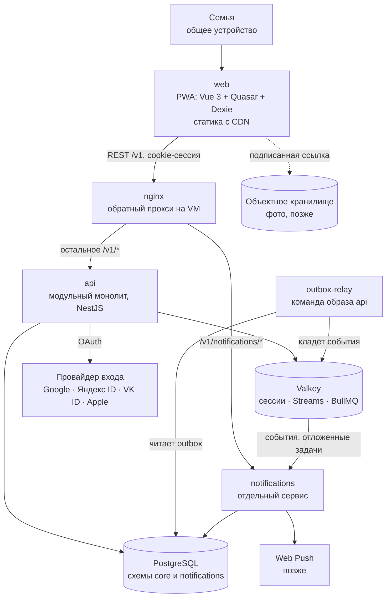
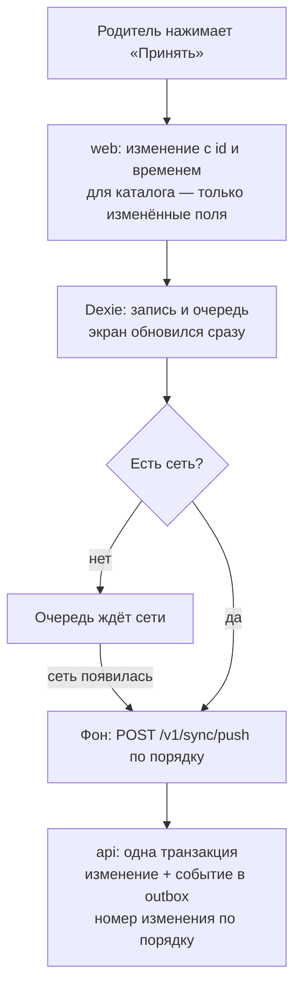

# ADR-001. Архитектура приложения: монорепозиторий, фронт, бэк и их связь

**Статус:** предложен, 18.10.2026.

Общая картина: из каких частей состоит Little Big Deals, где живёт код каждой части и как они
общаются. Подробности по каждой теме — в ADR-002…010; здесь только то, без чего не понять целое.

## Контекст

- Сейчас бэкенда нет. Приложение — PWA на Vue 3 + Quasar, все данные семьи лежат в IndexedDB
  (Dexie) одного устройства, хостинг — GitHub Pages. Фронт написан по Feature-Sliced Design,
  TypeScript strict, zod на границах, интерфейс на русском, английском и испанском.
- Бэкенд нужен, чтобы не терять данные при потере или сбросе устройства, чтобы приложением
  пользовались разные семьи и чтобы позже присылать уведомления. Проект заодно служит полигоном
  для событийной архитектуры.
- Нагрузка крошечная: 10 000 семей — это 1–2 записи в секунду в пике. Масштабировать по нагрузке
  не нужно.
- Работаем в двух независимых контурах, RU и EU, со своими базами, доменами и ключами. Первым
  поднимаем EU (ресерч `03`).
- Хотим менять API и клиент одним изменением и держать одну версию продукта, как сейчас.

## Решение

### 1. Один монорепозиторий

Фронт, бэк и общие пакеты живут в одном репозитории на npm workspaces:

```
kids-chores/
  apps/
    web/             нынешнее приложение: PWA на Vue 3 + Quasar + Dexie
    api/             модульный монолит: HTTP API и outbox-relay
    notifications/   отдельный сервис уведомлений
  packages/
    contracts/       zod-схемы запросов, ответов, изменений синка и событий
    changelog/       ченджлог продукта на русском, английском и испанском
  infra/
    nginx/           конфиг обратного прокси
  compose.yaml       локальное окружение, тот же состав, что на VM контура
  package.json       одна версия продукта на всё
```

- Одна версия в корневом `package.json`, один тег `vX.Y.Z` на всё, как сейчас.
- Правила кода из `CLAUDE.md` действуют во всех пакетах: TypeScript strict, стрелочные функции,
  без комментариев, типы из zod-схем.
- Turborepo не берём, пока сборка быстрая. Понадобится кеш сборок — добавим его.

### 2. Из чего состоит система



| Часть | Что делает | Технологии | Где работает |
|---|---|---|---|
| `web` | Интерфейс, работа без сети, очередь изменений | Vue 3, Quasar, Dexie, vue-i18n, PWA | Статика: EU — Cloudflare Pages, RU — облачное хранилище с CDN |
| `api` | Вся предметная логика, вход, синхронизация | NestJS на Fastify, Prisma, zod | Контейнер на VM контура |
| `outbox-relay` | Перекладывает события из Postgres в Valkey | Тот же образ, что `api`, другая команда | Контейнер на VM |
| `notifications` | Напоминания, push, лента уведомлений | NestJS, BullMQ, web-push | Контейнер на VM; сначала каркас |
| PostgreSQL | Главная копия данных | Схема `core` для `api`, схема `notifications` для уведомлений | EU — контейнер на VM, RU — managed |
| Valkey | Сессии, события, отложенные задачи, лимиты запросов | Streams, consumer groups, BullMQ | Контейнер на VM |
| nginx | Один адрес API, TLS, маршрут к нужному сервису | — | Контейнер на VM |

### 3. Фронт

- Остаётся PWA на Feature-Sliced Design. Подробные правила — ADR-003.
- После входа в аккаунт IndexedDB перестаёт быть единственной копией: это рабочая копия на
  устройстве, а главная копия — на сервере. Гость, как сейчас, работает только с устройством
  (ADR-008).
- Репозитории в `entities/*/api` пишут в Dexie и в очередь, очередь уходит на сервер в фоне.
  Страницы, виджеты и фичи про сеть не знают и не меняются.
- Схемы запросов и ответов фронт берёт из `packages/contracts` — те же, по которым их проверяет
  сервер.
- Сборка одна на оба контура: адрес API выбирается при запуске по домену, на котором открыто
  приложение.

### 4. Бэк

- `api` — модульный монолит: модули Identity, Family, Children, Tasks, Rewards, Ledger, Settings,
  Sync, Backup, Meta. Модули знают друг о друге только через публичный интерфейс модуля и через
  события, чужие таблицы не читают. Почему не микросервисы: домены маленькие, тесно связаны и
  меняются вместе, а распределённые транзакции нам ни к чему.
- `notifications` — отдельный сервис с первого дня: у рассылок свой характер нагрузки и свои
  внешние зависимости, а с ядром им хватает событий. Сначала это каркас, который читает события и
  пишет их в лог.
- Данные семьи изолированы дважды: `family_id` берётся только из сессии, а Postgres сам не
  отдаёт чужие строки (Row-Level Security).
- Подробная структура бэка — ADR-005, события — ADR-006, данные — ADR-007, вход — ADR-008.

### 5. Как фронт и бэк общаются

**Один адрес API.** Фронт открыт на `app.<домен>`, API — на `api.<домен>`. Это один сайт, поэтому
Safari отдаёт cookie сессии. nginx отправляет `/v1/notifications/*` в `notifications`, остальное
`/v1/*` — в `api`. Локально всё открыто с одного адреса через тот же nginx.

**Контракт.** REST и JSON, путь `/v1`. Схемы запросов и ответов — zod в `packages/contracts`:
сервер проверяет по ним входящие данные и строит из них описание API в OpenAPI, фронт проверяет
по ним ответы.

**Вход и сессия.** Вход пока необязателен: гость работает только с устройством, и в сайдбаре
висит плашка, что данные не синхронизируются. Родитель входит на каждом устройстве через Google,
Яндекс ID, VK ID или Apple, а после первого входа — по Face ID или Touch ID (passkey). Своих
паролей нет. После входа сервер ставит cookie `httpOnly; Secure; SameSite=Lax`, сама сессия
лежит в Valkey 30 дней и продлевается при каждом запросе. Изменяющие запросы дополнительно
проверяются по заголовку `Origin`. Родительский режим и PIN остаются замком на устройстве: сервер
доверяет сессии, PIN отделяет родителя от ребёнка на общем планшете. Подробно — ADR-008.

**Совместимость клиента.** PWA присылает версию в заголовке `X-App-Version`. Если она старше
`minClientVersion` сервера, сервер отвечает `426`, и приложение обновляет себя. `GET /v1/meta`
отдаёт версию сервера, `minClientVersion` и коммит.

**Запись данных.** Один путь для работы с сетью и без неё:



- У каждого изменения свой id: если запрос повторился из-за обрыва связи, сервер применит его
  один раз.
- Сервер нумерует принятые изменения, по номеру устройство забирает только новое. Чьё изменение
  поля свежее, решает время изменения на устройстве; время из будущего сервер заменяет своим.
- Конфликты разбираются по правилам из ADR-004: каталог и настройки сливаются по полям, покупка
  без баланса принимается в минус, отметка задачи за день одна.
- При открытии приложения и при возврате в него фронт забирает с сервера изменения с последнего
  известного номера.
- После первого входа данные гостя уходят на сервер в фоне и сливаются с данными семьи без
  вопросов. Новое устройство после входа скачивает всё с сервера.

**Уведомления, позже.** Подписка на Web Push и лента уведомлений идут в `notifications` по
`/v1/notifications/*`; сессию он проверяет сам, читая её из Valkey.

### 6. Как сервисы общаются между собой

- Только событиями. `api` пишет событие в таблицу `outbox` в той же транзакции, что и данные.
  `outbox-relay` перекладывает события в Valkey Streams. Каждый потребитель читает их своей
  группой и помнит, какие события уже обработал. Подробно — ADR-006.
- Отложенные задачи вроде «напомнить в 18:00 по времени семьи» — очередь BullMQ внутри
  `notifications`.
- Сервисы не вызывают друг друга по HTTP и не читают чужие таблицы. Упал `notifications` — `api`
  работает, события копятся и обработаются после перезапуска.

### 7. Версии и совместимость

- Одна версия продукта: major — ломающее для пользователя или старых клиентов, minor — новые
  возможности, patch — исправления, в том числе только серверные.
- Внутри `/v1` только добавляющие изменения, ломающее — `/v2` рядом со старым. У событий — версия
  в конверте. Миграции базы — сначала добавить, потом убрать старое отдельным релизом. Старые
  форматы бэкапа и изменений синка сервер поднимает до текущего, а не отклоняет.
- Ченджлог — на трёх языках; как он переезжает в базу — ADR-002.

### 8. Сборка, деплой и окружения

- `web` собирается в статику. `api` и `notifications` — в образы контейнеров, на VM контура их
  запускает Compose вместе с nginx и Valkey.
- Порядок выкатки: миграции базы → `api`, `outbox-relay` и `notifications` → фронт.
- CI на пул-реквесте проверяет только изменившиеся части; изменился `contracts` — проверяется
  всё. На `main` всё собирается один раз и выкатывается по контурам с ручным подтверждением.
  Staging нет.
- Локально — тот же Compose, через Docker или Podman. Состав и команды — ADR-005.

## Рассмотренные варианты

| Вопрос | Варианты | Почему выбрали так |
|---|---|---|
| Репозиторий | Отдельные репозитории для фронта и бэка; **один монорепозиторий** | Изменение API и клиента — один пул-реквест, общие схемы без публикации пакета, одна версия |
| Форма бэка | Микросервисы по доменам; один монолит на всё; **модульный монолит + выделенные сервисы** | Домены связаны и меняются вместе, а у уведомлений своя нагрузка и свой жизненный цикл |
| Контракт | tRPC; ts-rest; **REST + zod + OpenAPI** | REST понятен любому клиенту, zod уже используется во фронте, OpenAPI получается из тех же схем |
| Сессия | JWT в localStorage; **cookie с сессией на сервере** | Скрипт не прочитает cookie, сессию можно отозвать, Safari не обрезает её через 7 дней |
| Синхронизация | Dexie Cloud, RxDB, PowerSync, ElectricSQL; **своя очередь в Dexie + REST** | Готовые движки решают правку одного и того же многими в реальном времени, а взамен требуют уйти с Dexie или держать ещё один сервис |

## Последствия

- Текущее приложение переезжает в `apps/web`. Меняются пути в `deploy.yml`, `tag.yml`, скриптах и
  `CLAUDE.md`. Базовый путь `/kids-chores/` уходит, когда приложение переедет на свой домен.
- На новом домене IndexedDB пустая: данные единственной семьи переносим экспортом и импортом,
  отдельный механизм переезда не делаем.
- Нужен свой домен, на котором фронт и API — один сайт. Иначе Safari не отдаст cookie сессии.
- Репозитории в `entities/*/api` пишут в Dexie и в очередь, синхронизация идёт в фоне. В Dexie
  появляется таблица очереди, у отметок и покупок — пометка удаления, у каталога и настроек —
  время изменения полей, id отметки вычисляется из ребёнка, задачи и дня, у пресетов — постоянные
  id.
- PIN хранится хешем уже у гостя, поэтому на сервер открытым текстом он не попадает.
- Баланс и серии сейчас считает фронт. Если они понадобятся серверу, расчёт переезжает в общий
  пакет, а не копируется.
- Решения по отдельным темам — ADR-002 (версии и ченджлог), ADR-003 (фронт), ADR-004 (синк),
  ADR-005 (структура бэка и локальное окружение), ADR-006 (события), ADR-007 (данные), ADR-008
  (вход), ADR-009 (персональные данные), ADR-010 (уведомления).
