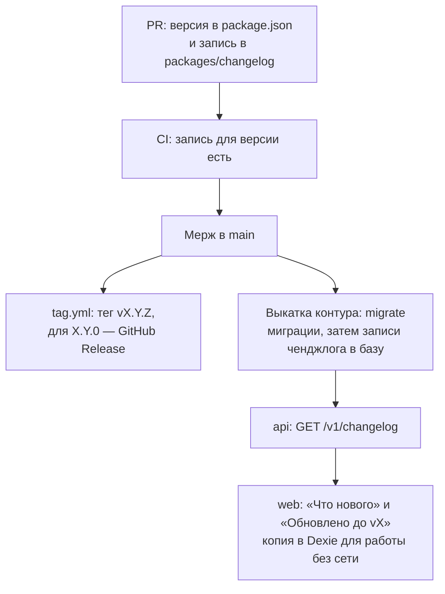

# ADR-002. Версии, ченджлог и совместимость

**Статус:** предложен, 20.10.2026.

Одна версия продукта на весь монорепозиторий, один ченджлог на трёх языках и правила, по которым
старая PWA на устройстве продолжает работать с новым сервером. Общая картина — ADR-001, §7.

## Контекст

- Сейчас версионируется только фронт. Версия лежит в корневом `package.json` (сейчас `0.6.0`),
  Vite подставляет её в футер бокового меню.
- Ченджлог — `apps/web/src/entities/app-version/model/changelog.ts`. У записи есть версия, дата и
  тексты `notes` на русском, английском и испанском, тип требует все три языка. Из него
  строятся экран «Что нового» и уведомление «Обновлено до vX»: устройство помнит увиденные версии
  в таблице `versionLog`.
- Тег `vX.Y.Z` ставит CI (`tag.yml`) после мержа в `main`. Для `X.Y.0` CI публикует GitHub Release:
  `apps/web/scripts/releaseNotes.mjs` собирает русские тексты всех записей после предыдущей
  `X.Y.0`.
- У бэкапа JSON своя версия формата — `BACKUP_VERSION`, сейчас 5.
- С бэкендом версии появляются у API, событий, схемы базы и изменений синхронизации. Выходят они
  не одновременно: PWA обновляется на устройстве лениво, через service worker, и может жить
  неделями, а `api` и `notifications` выкатываются сразу и в два контура, RU и EU.
- Разработчиков один-два. Отдельные версии у каждого пакета и таблица их совместимости — лишняя
  работа.

## Решение

### 1. Одна версия продукта

- Версия одна — в корневом `package.json`. Фронт, `api` и `notifications` собираются из одного
  коммита с этой версией. `api` читает её при старте и отдаёт в `GET /v1/meta`.
- Каждая сборка дополнительно знает свой коммит (`GIT_COMMIT`): он виден в `GET /v1/meta` и в
  логах.
- Номер версии — три числа `major.minor.patch`:
  - **major** — ломающее для пользователя или для старых клиентов, например новый `/v2`;
  - **minor** — новые возможности;
  - **patch** — исправления, в том числе только серверные.

### 2. Ченджлог в репозитории

Ченджлог переезжает из фронта в отдельный пакет данных `packages/changelog`. Это единственный
источник для «Что нового», для GitHub Release и для базы контура.

```ts
{
  version: '0.7.0',
  date: '2026-11-02',
  notes: {
    ru: ['Данные сохраняются в аккаунте'],
    en: ['Your data is saved to your account'],
    es: ['Tus datos se guardan en tu cuenta'],
  },
  internal: ['api: вход через Google и dev-вход', 'db: таблицы семьи и RLS'],
}
```

- `notes` — то, что видит пользователь, на трёх языках приложения. Тип требует все три: без
  перевода проверка типов не пройдёт.
- `notes` может быть пустым у патча, который поменял только сервер. Тогда уведомления
  «Обновлено до vX» нет — пользователь не видит пустого обновления.
- `internal` — технические изменения по частям (`api:`, `notifications:`, `web:`, `db:`), только на
  русском. Попадают только в GitHub Release.
- Запись обязательна для каждой версии. Она проходит ревью в PR вместе с кодом, а CI на PR падает,
  если для версии из корневого `package.json` записи нет.

### 3. Ченджлог в базе и «Что нового»



- В схеме `core` есть таблица `changelog_entries`: версия, дата, тексты по языкам и `internal`. Это
  не данные семьи, у неё нет `family_id` и защиты строк.
- Разовый `migrate` после миграций заливает в неё все записи из `packages/changelog`, который
  лежит в образе. Повторная заливка той же версии перезаписывает запись, поэтому опечатку в
  тексте исправляет следующая выкатка `api`, без пересборки фронта.
- `GET /v1/changelog` открыт без сессии: «Что нового» видит и гость на домене контура. Ответ —
  все записи сразу на всех языках, без `internal`. Тексты маленькие, зато смена языка работает
  без сети.
- Фронт хранит последнюю полученную копию в Dexie и показывает «Что нового» из неё, если сети
  нет.
- «Обновлено до vX» показывается, как сейчас, когда устройство впервые видит новую версию, — и
  только если у записи этой версии `notes` не пустой.
- Пока приложение живёт на GitHub Pages, где API нет, ченджлог остаётся вшитым в сборку как
  запасная копия. После переезда на домен контура вшитая копия уходит.

### 4. Клиент и сервер: `X-App-Version` и `426`

- PWA присылает свою версию в заголовке `X-App-Version` в каждом запросе к API.
- `MIN_CLIENT_VERSION` — переменная окружения `api` своего контура. Её же отдаёт `GET /v1/meta`.
- Версия клиента ниже минимума или заголовка нет — сервер отвечает `426` и присылает
  `minClientVersion`. Без проверки остаются `GET /v1/meta`, `GET /v1/changelog` и
  `GET /v1/auth/:provider/start` и `callback`: по ним браузер переходит сам, без заголовков.
- Получив `426`, PWA показывает «Доступна новая версия, обновляем», запрашивает новую версию у
  service worker и перезагружается. Очередь изменений остаётся в Dexie, после обновления она
  уходит на сервер — ничего не теряется.
- Минимум поднимаем, только когда сервер перестаёт понимать старых клиентов: убрали `/v1`,
  перестали поднимать старый формат изменений или старая версия портит данные.
- Минимум поднимаем отдельной выкаткой, когда фронт нужной версии уже раздаётся. Иначе старые
  клиенты получат `426`, а обновиться им будет не на что.

### 5. Контракты совместимости

Версия продукта говорит, что вышло. Совместимость старой PWA с новым сервером держат отдельные
контракты:

| Контракт | Как версионируем | Правило |
|---|---|---|
| HTTP API | Путь `/v1` | Внутри `/v1` — только добавляющие изменения: новые поля и эндпоинты не обязательны для клиента. Ломающее — `/v2` рядом со старым; `/v1` живёт, пока `minClientVersion` не поднимется выше последней версии, которая им пользуется |
| События | Конверт `{ eventId, type, version, occurredAt, familyId, payload }` | Новые поля — добавляющие. Ломающее — новая `version` события: продюсер какое-то время пишет обе, потребители понимают обе (ADR-006) |
| Схема базы | Нумерованные миграции Prisma | Сначала добавить колонку или таблицу, выкатить код, убрать старое отдельным релизом. Во время выкатки старый и новый `api` работают с одной схемой (ADR-007) |
| Изменения синхронизации | `schemaVersion` у каждого изменения | Сервер поднимает старое изменение до текущего формата, а не отклоняет. Код подъёма живёт, пока версия, которая так пишет, не ниже `minClientVersion` (ADR-004) |
| Бэкап JSON | `BACKUP_VERSION` | Файл любой старой версии читает фронт снисходительными схемами, как сейчас. На сервер данные уходят обычными изменениями. Экспорт с сервера — всегда в текущем формате |

### 6. Контуры на разных версиях

- Порядок выкатки в контуре: миграции → `api`, `outbox-relay` и `notifications` → фронт. Фронт
  выходит последним, поэтому новый фронт не обращается к старому серверу.
- RU и EU выкатываются по очереди и могут стоять на разных версиях. Поэтому версия сервера для
  приложения — всегда из `GET /v1/meta` своего контура, а не из сборки фронта.
- В футере бокового меню — версия приложения. Если версия сервера другая, она показывается рядом.
- Откатываем контур целиком: `api` и фронт вместе, чтобы фронт не оказался новее сервера.
  Миграции не откатываем — по правилу «сначала добавить, потом убрать» старый `api` работает с
  новой схемой.

### 7. Теги, релизы и сборки

- После мержа в `main` `tag.yml` читает версию из корневого `package.json` и ставит тег
  `vX.Y.Z`, если такого ещё нет, — как сейчас.
- Для `X.Y.0` CI публикует GitHub Release. Заметки собирает `releaseNotes.mjs` из
  `packages/changelog`: все записи после предыдущей `X.Y.0`, русский `notes` и `internal`.
- Патч даёт только тег. Его запись попадёт в следующий релиз.
- Сборка одна на коммит: статика фронта и образы `api` и `notifications`, помеченные версией и
  коммитом. Контуры выкатывают одну и ту же сборку с ручным подтверждением (ADR-001, §8).

### 8. Правила в `CLAUDE.md`

Когда ченджлог переедет, раздел «Версии» меняется так:

1. Корневой `package.json` → `version`.
2. `packages/changelog` → новая запись сверху: дата, `notes` на трёх языках, при необходимости
   `internal`. У серверного патча `notes` может быть пустым.
3. Текст коммита — с номером версии в скобках.

Шаг про `changelog.ts` во фронте уходит.

## Рассмотренные варианты

| Вопрос | Варианты | Почему выбрали так |
|---|---|---|
| Сколько версий | Своя у каждого пакета: changesets, теги `web@` и `api@`; **одна на продукт** | Один тег, один ченджлог, один релиз — сразу понятно, что с чем совместимо. Матрица версий для одного-двух разработчиков лишняя |
| Где живёт ченджлог | Вшит во фронт, как сейчас; только в базе, правка через админку; **в репозитории, в базу его заливает выкатка** | Запись проходит ревью в PR и проверку в CI. Фронт не тащит растущий ченджлог в сборке, «Что нового» соответствует тому, что стоит в контуре, а опечатку исправляет выкатка `api` |
| Серверный патч | Не поднимать версию; **поднимать с пустыми `notes`** | У каждого изменения на проде есть тег и запись, а пользователь не видит пустого «Обновлено» |
| Слишком старый клиент | Пусть ломается; предупреждение без блокировки; **`426` и принудительное обновление** | Старый клиент может записать данные в формате, который сервер уже не понимает. Очередь при этом не теряется |
| Ломающее изменение API | Версия в заголовке запроса; **новый путь `/v2`** | Путь видно в логах, в nginx и в OpenAPI, старые клиенты ничего не замечают |

## Последствия

- Появляется `packages/changelog`; записи переезжают туда из
  `apps/web/src/entities/app-version`. `releaseNotes.mjs` читает этот пакет и добавляет `internal`
  в GitHub Release.
- В CI на PR — проверка, что для версии из корневого `package.json` есть запись.
- В схеме `core` — таблица `changelog_entries`, `migrate` заливает в неё записи после миграций.
- В `api` — `GET /v1/changelog` и guard версии клиента с перечнем исключений.
- Во фронте: заголовок `X-App-Version` во всех запросах, обработка `426`, «Что нового» из API с
  копией в Dexie, вторая версия в футере, если сервер на другой версии.
- Раздел «Версии» в `CLAUDE.md` переписывается вместе с переездом ченджлога.
