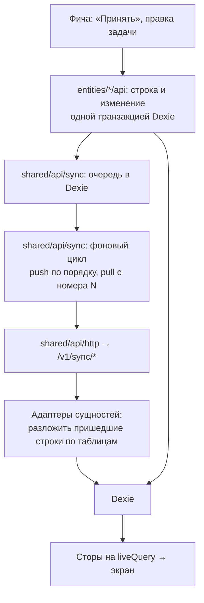

# ADR-003. Архитектура фронта

**Статус:** предложен, 20.10.2026.

Как устроен код PWA в `apps/web`: что уже работает и остаётся правилом, и где живёт то, что
добавляет бэкенд, — вход, синхронизация, Face ID и новый PIN. Общая картина — ADR-001, правила
синхронизации — ADR-004, вход — ADR-008.

## Контекст

- Фронт — Vue 3, Quasar, pinia и Dexie, TypeScript strict, zod на границах. Код разложен по
  Feature-Sliced Design (FSD) с версии 0.2.0: слои, слайсы и сегменты описаны в `src/README.md`,
  правила — в `CLAUDE.md`.
- Все данные семьи сейчас в IndexedDB устройства. Сторы сущностей подписаны на Dexie через
  `liveQuery`, поэтому экран сам обновляется после любой записи в базу.
- Доступ к данным уже собран в `entities/*/api`: репозитории каталога работают через общий
  `createCatalogue` из `shared/api`, а на устройствах лежат строки всех прошлых версий.
- С бэкендом появляются гость и аккаунт, очередь изменений, фоновая отправка и получение, экран
  входа, Face ID, хеш PIN и новый сброс PIN.
- Приложение открывается и там, где API нет: на GitHub Pages до переезда на свой домен.

## Решение

### 1. Слои и слайсы — как сейчас

| Слой | Что лежит |
|---|---|
| `app` | Сборка: провайдеры, роутер, стили, запуск при старте |
| `pages` | Экраны целиком |
| `widgets` | Самостоятельные части экрана: доска задач, копилки, награды, боковое меню |
| `features` | Действия пользователя: вход в родрежим, выдача награды, бэкап, правка каталога |
| `entities` | Предметные сущности: схема, состояние, доступ к данным |
| `shared` | Код без предметной области: база, сеть, утилиты, UI-кит, словари |

- Импорт только вниз по слоям, внутри слоя — нельзя.
- В слайс входят только через `index.ts`. Сущности не импортируют друг друга, кроме явных входов
  `@x`; сейчас их два, оба для `entities/wallet`.
- Сегменты: `ui`, `model`, `api`, `lib`, `config`. Типы — в `types.ts`, константы — в
  `constants.ts` своего сегмента.
- Состояние — pinia: доменное в `entities/*/model`, состояние действий в `features/*/model`. Общей
  папки сторов нет.
- Новый код кладём в существующий слайс или заводим новый, а не в «общую» папку.
- Строки интерфейса — только через словари `shared/i18n/messages` на трёх языках.
- Экраны — страницы с маршрутом; окнами остаются только короткие шаги внутри действия.

### 2. Данные на устройстве

- Dexie — рабочая копия. У гостя она единственная, после входа главная копия — на сервере.
- zod стоит на границах: чтение из IndexedDB, импорт JSON, ответы API. Дальше по слоям идут
  обычные типы, выведенные через `z.infer`.
- Схемы чтения (`stored*`) снисходительны к старым строкам: новое обязательное поле добавляется
  как необязательное с подстановкой значения. Миграции схемы на устройствах нет, история
  пользователя не должна пропасть.
- `completions.points` и `spends.cost` — снимки цены на момент события. Правка каталога их не
  двигает.
- Баланс, серии и бейджи считаются из истории и не хранятся.

### 3. Сеть — только через `shared/api`

- `shared/api/http` — единственное место, где фронт делает запросы: префикс `/v1`, cookie
  сессии, заголовок `X-App-Version`, проверка ответа zod-схемой.
- Схемы запросов, ответов и изменений синхронизации фронт берёт из `packages/contracts` — те же,
  по которым их проверяет сервер. Схемы чтения IndexedDB остаются во фронте: они снисходительнее
  серверных.
- `401` переводит аккаунт в состояние «нужно войти снова», `426` — обновляет приложение и
  показывает «Обновите приложение».
- Вызывают `shared/api` только репозитории `entities/*/api` и запуск в `app`. Страницы, виджеты и
  фичи про сеть не знают.

### 4. Есть ли API

- В `shared/config` лежит таблица доменов: адрес, на котором открыто приложение, → адрес API.
  Локально и в Compose API на том же адресе по `/v1`, на домене контура — `api.<домен>`.
- Домена нет в таблице — API нет: приложение работает только гостем, без плашки и экрана входа.
  Так работает GitHub Pages.
- Если API есть, при запуске приложение спрашивает `GET /v1/meta`: версии, включённые способы
  входа и dev-вход. Ответ кешируется, чтобы без сети экран входа знал, что показать.

Почему таблица, а не только запрос к `meta`: без сети нельзя отличить «API нет» от «сети нет», а
таблица отвечает сразу и одинаково в любом состоянии сети. Новый контур — одна строка в таблице.

### 5. Аккаунт и устройство

- Новая сущность `entities/account` — кто вошёл на этом устройстве: гость, аккаунт или «нужно
  войти снова», семья и есть ли passkey. Её `api` — `GET /v1/me`, выход и вызовы passkey.
- `entities/parent-session` остаётся замком родрежима и с аккаунтом не смешивается: аккаунт — это
  чьи данные, родрежим — кто сейчас держит планшет.
- Настройки делятся на семейные и настройки устройства. Бонус, этапы серии и хеш PIN — в
  `settings`, они синхронизируются. Язык, незаконченное знакомство, состояние аккаунта, последний
  полученный номер изменения и счётчик попыток PIN — в новой таблице Dexie `device`, на сервер не
  едут. Старая строка `settings` с языком читается как раньше, язык переносится в `device` при
  первом запуске новой версии.

### 6. Синхронизация

- **Запись.** Репозиторий сущности пишет строку и, если вошли в аккаунт, кладёт изменение в
  очередь — одной транзакцией Dexie. Для каталога и настроек в изменение попадают только
  изменённые поля, а у строки обновляется время изменения каждого поля (`fieldChangedAt`). У
  гостя время полей тоже ведётся, очереди нет.
- **Движок** живёт в `shared/api/sync` и про предметную область не знает: очередь, номер
  последнего изменения, отправка по порядку, получение с номера, повтор при обрыве связи.
- **Адаптеры.** Каждая сущность через свой `index.ts` отдаёт адаптер: какой таблице принадлежат
  строки, как их прочитать схемой и как выгрузить все строки как изменения для первого входа.
- **Запуск.** `app/model` собирает адаптеры всех сущностей и запускает движок: при старте, при
  возврате в приложение, при появлении сети и сразу после новой записи в очередь. Приложение
  гостем — движок не запускается.
- **Первый вход.** Движок выгружает данные гостя через адаптеры как изменения и отправляет их
  обычной очередью, потом забирает состояние семьи (ADR-004).
- Пришедшие строки ложатся в Dexie, а сторы уже подписаны на неё — экран обновляется сам, без
  отдельной логики в фичах.
- Признак «нет сети, изменения отправятся позже» берётся из движка и показывается в шапке.

### 7. Вход, выход и Face ID

| Что | Где | Что делает |
|---|---|---|
| Плашка гостя | `widgets/side-menu` | «Данные хранятся только на этом устройстве» и кнопка «Войти»; видна, только если API есть и вход не выполнен |
| Экран входа | `pages/sign-in`, маршрут `/sign-in` | Кнопки включённых провайдеров, «Войти по Face ID», при dev-входе — поле имени |
| Вход | `features/sign-in` | Переход на `/v1/auth/:provider/start` целой страницей, вход по passkey, dev-вход, ввод кода передачи входа на iOS, если он понадобится |
| Выход | `features/sign-out` | Дослать очередь, `POST /v1/auth/logout`, удалить локальную базу; предупредить о неотправленном. То же предупреждение — перед входом в другой аккаунт |
| Face ID в настройках | `features/edit-settings` | Включить или отключить passkey, предупреждение про код iPad |
| Вызовы passkey | `entities/account/api` | Обёртка над `@simplewebauthn/browser`: ими пользуются вход, родрежим и настройки, поэтому они ниже фич |

Вход у провайдера — переход целой страницей, а не `fetch`: провайдер показывает свою страницу, а
сервер возвращает в приложение уже с cookie. После возврата приложение спрашивает `GET /v1/me`
и запускает синхронизацию.

### 8. PIN

- Хеш и проверка — чистые функции в `entities/settings/lib`: PBKDF2 из WebCrypto с солью семьи.
  PIN принадлежит настройкам, поэтому функции лежат при них.
- Схема чтения настроек принимает и старый открытый PIN; при первом запуске новой версии он
  переводится в хеш и больше нигде не хранится.
- `features/parent-login` проверяет PIN по хешу, считает попытки и выдерживает паузу после пяти
  неверных подряд. С passkey на устройстве первым предлагает Face ID.
- «Забыли PIN?» в `features/parent-login` показывает доступные способы: у гостя — пример, как
  сейчас; с аккаунтом — Face ID, повторный вход тем же аккаунтом и подсказку сменить PIN на другом
  устройстве (ADR-008).

### 9. Постоянные id пресетов

- id пресетов первого запуска — постоянные UUID в `features/starter-presets/model/constants.ts`,
  одинаковые на всех устройствах. Время изменения всех их полей — ноль, поэтому любая правка
  родителя свежее пресета.
- id отметки вычисляется из ребёнка, задачи и дня как UUID версии 5 — детерминированный UUID из
  строки: подходит под тип id на сервере и одинаков на всех устройствах. Старые отметки со
  случайными id получают вычисленный id при обновлении базы.

## Рассмотренные варианты

| Вопрос | Варианты | Почему выбрали так |
|---|---|---|
| Архитектура | Папки по типу (`components`, `stores`); **FSD** | FSD уже работает с 0.2.0: зависимости идут в одну сторону, место нового кода понятно |
| Где синхронизация | Каждый репозиторий сам ходит в API; фича, которая импортирует все сущности; **движок в `shared`, адаптеры в сущностях, запуск в `app`** | Очередь нужна сущностям, значит она ниже них. Движку не нужно знать предмет, а `app` — единственное место, которое видит все сущности сразу |
| Есть ли API | Флаг сборки; только запрос к `meta`; **таблица доменов и `meta` для подробностей** | Одна сборка на все контуры; без сети ответ тот же, что с сетью |
| Настройки устройства | Те же строки `settings` с полями, которые не синхронизируются; **отдельная таблица `device`** | Граница видна в схеме: всё в `settings` уезжает на сервер, всё в `device` — нет |
| id отметки | Склейка строк; случайный UUID; **UUID v5 из ребёнка, задачи и дня** | Одинаков на всех устройствах и подходит под тип UUID в базе |
| Вход | Окно поверх экрана; **страница `/sign-in`** | Экраны в приложении — страницы, окна только для коротких шагов; провайдер всё равно уводит со страницы |
| Состояние | Общий стор приложения; **pinia по слайсам** | Как сейчас: состояние лежит рядом со смыслом |

## Последствия

- Новые слайсы: `entities/account`, `pages/sign-in`, `features/sign-in`, `features/sign-out`; в
  `shared/api` — `http` и `sync`; таблица доменов в `shared/config`.
- Новая версия базы Dexie: таблицы очереди и `device`, `fieldChangedAt` у каталога и настроек,
  `deletedAt` у отметок и покупок, пересчёт id старых отметок.
- Репозитории `entities/*/api` пишут строку и изменение одной транзакцией; `createCatalogue`
  ведёт время изменения полей сам, поэтому вызовы в фичах не меняются.
- Каждая сущность отдаёт адаптер синхронизации через `index.ts`; `src/README.md` описывает
  движок, адаптеры и границу `settings` / `device`.
- Во фронте появляется зависимость `@simplewebauthn/browser`.
- Новые строки интерфейса — плашка, экран входа, выход, Face ID, сброс PIN, «нет сети» — на трёх
  языках.
- API на `api.<домен>` — другой адрес, чем приложение: запросам нужен `credentials: 'include'`, а
  серверу — CORS с разрешёнными cookie для `PUBLIC_ORIGIN` (ADR-008).
- «Что нового» берёт записи из `GET /v1/changelog` и держит копию в Dexie (ADR-002).
- Аватарки вместо фото в редакторе ребёнка и загрузка картинок вариантов по подписанной ссылке —
  ADR-009.
- С уведомлениями (ADR-010) появляются страница `pages/notifications`, счётчик непрочитанных в
  сайдбаре и свой service worker: `vite-plugin-pwa` переходит в режим `injectManifest`, где
  service worker пишем сами.
