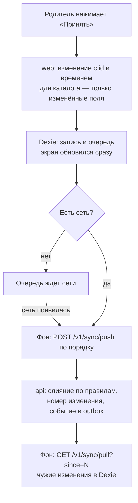

# ADR-004. Работа без сети и синхронизация

**Статус:** предложен, 19.10.2026.

Как данные попадают с устройства на сервер и обратно, как сливаются данные гостя после входа и
кто побеждает, когда одно и то же поменяли на двух устройствах. Таблицы — ADR-007, вход —
ADR-008.

## Контекст

- Сейчас всё лежит в IndexedDB одного устройства, сервера нет.
- Вход пока необязателен (ADR-008): гость работает только с устройством, синхронизация — только с
  аккаунтом.
- Семья пользуется несколькими устройствами: общим планшетом и телефоном родителя. Планшет может
  долго быть без сети.
- Родитель не должен разбираться, где свежие данные. Всё сливается в фоне, без вопросов.
- Мгновенное обновление на всех устройствах не нужно: хватит забирать изменения при открытии
  приложения и при возврате в него.

## Решение

### 1. Режимы

| Режим | Как работает |
|---|---|
| Гость | Только устройство. Очереди и синхронизации нет |
| Аккаунт | Каждое изменение пишется в Dexie и в очередь, экран обновляется сразу. Очередь уходит на сервер в фоне, как только есть сеть |

Главная копия данных семьи — на сервере. Dexie на устройстве — рабочая копия и очередь.

### 2. Слепок свежести

- Каждое изменение — `{ mutationId, type, schemaVersion, entityId, fields, changedAt }`. Для каталога
  и настроек `fields` — только изменённые поля. `changedAt` — время изменения по часам устройства.
- Сервер хранит у каждого поля каталога и настроек время его последнего изменения
  (`field_changed_at`, ADR-007). Пришедшее значение поля принимается, только если оно сделано не
  раньше сохранённого.
- Время из будущего сервер заменяет своим текущим. Одинаковое время — побеждает пришедшее позже.
- Сервер нумерует принятые изменения внутри семьи по порядку. Устройство помнит последний номер,
  который забрало, и спрашивает только то, что новее.

### 3. Первый вход с данными гостя

- После входа данные гостя превращаются в изменения: каждая запись — с её `updatedAt` как временем
  изменения. Они уходят на сервер в фоне, как обычная очередь.
- Сервер сливает их по тем же правилам: одна и та же запись — в каждом поле побеждает более
  свежее; новые записи добавляются; отметки и покупки объединяются, отметка ребёнка за задачу и
  день — одна.
- Если данных на устройстве нет, приложение скачивает всё с сервера (`GET /v1/sync/snapshot`).
- Приложение ничего не спрашивает и не предлагает сохранить JSON.
- **Пресеты.** У пресетов первого запуска постоянные id, одинаковые на всех устройствах, а время
  изменения — ноль. Пресеты с двух устройств сливаются в одну запись, и любая правка родителя
  свежее пресета.
- Детей и задачи, которые завели вручную на двух устройствах независимо, сервер одинаковыми не
  считает — получаются дубли, лишнее родитель убирает сам. Склеивать записи по имени не будем.

### 4. Когда идёт синхронизация

- Очередь отправляется сразу после изменения, при открытии приложения, при возврате в него и когда
  появилась сеть. Порядок изменений в очереди сохраняется.
- Чужие изменения забираются при открытии приложения, при возврате в него и после каждой отправки.
- Новое устройство или устройство после сброса получает всё состояние через `snapshot`.
- Сессия кончилась — очередь копится, после входа тем же аккаунтом уходит на сервер (ADR-008).
- В интерфейсе видно, что сети нет и изменения отправятся позже.

### 5. Конфликты

| Ситуация | Итог |
|---|---|
| Одну запись каталога или настройки поменяли на двух устройствах | Разные поля — сохраняются оба изменения. Одно поле — побеждает сделанное позже |
| Купили награду без сети, а на сервере баланса уже не хватает | Покупка принимается, баланс уходит в минус. Награда уже выдана — родитель видит пометку и решает сам: откатить покупку или оставить |
| Одну задачу за один день отметили дважды | Одна отметка, баллы не удваиваются |
| Одна сторона отметила задачу, другая сняла отметку | Побеждает сделанное позже |
| Одна сторона убрала задачу или награду в архив, другая потом её поправила или купила | Правка, сделанная позже архивации, возвращает запись из архива. Если возврат не нужен — родитель убирает ещё раз |

### 6. Правила, на которых всё держится

| Правило | Зачем |
|---|---|
| У каждого изменения свой id | Изменение, отправленное дважды из-за обрыва связи, применяется один раз |
| Каталог и настройки отправляют только изменённые поля | Иначе не слить по полям |
| Свежесть — по времени изменения на устройстве | Пришло на сервер последним — не значит сделано последним: планшет, долго пролежавший без сети, затёр бы свежие правки |
| Номер изменения выдаёт сервер | По номеру устройство забирает только новое |
| Ничего не удаляем, а помечаем | Другое устройство узнаёт об удалении, правка возвращает из архива |
| id отметки вычисляется из ребёнка, задачи и дня | Две отметки одной задачи за день — одна строка |
| День отметки — по часовому поясу семьи | Отметка «за вторник» не уезжает в среду из-за UTC |
| Баланс и серии считаются из истории | После слияния они пересчитываются сами |
| Сервер отклоняет только некорректные данные | Например, отметку несуществующему ребёнку. Приложение показывает, что не прошло |
| Старые версии изменений сервер поднимает до текущей | Устройство со старой версией приложения не теряет очередь |

### 7. Переезд с `siritoskon.github.io`

На новом домене IndexedDB пустая. Семья выгружает JSON на старом адресе, загружает его на новом и
входит в аккаунт — дальше данные уходят на сервер по разделу 3. На старом адресе — страница
«Приложение переехало» со ссылкой.

## Рассмотренные варианты

| Вопрос | Варианты | Почему выбрали так |
|---|---|---|
| Чьё изменение свежее | По порядку прихода на сервер; **по времени изменения на устройстве** | Порядок прихода отдаёт победу тому, кто дольше был без сети. Часы устройства могут врать, поэтому время из будущего сервер заменяет своим |
| Запись при сети | Ждать ответа сервера; **писать локально и отправлять в фоне** | Один путь с сетью и без неё, экран не ждёт сервер |
| Данные гостя при входе | Спросить, чьи оставить; заменить серверными; **слить в фоне** | Родителю не нужно решать, где свежее; правила те же, что для работы без сети |
| Готовый движок | Dexie Cloud; RxDB; PowerSync; ElectricSQL; **своя очередь в Dexie и REST** | Готовые решают правку одного и того же многими в реальном времени, а взамен требуют уйти с Dexie или держать ещё один сервис. PowerSync — запасной вариант, если своя очередь не справится |

## Последствия

- В Dexie появляются таблица очереди, последний полученный номер изменения, время изменения полей
  у каталога и настроек, `deletedAt` у отметок и покупок.
- Репозитории в `entities/*/api` пишут в Dexie и в очередь; отправка и получение идут в фоне.
  Место синхронизации в слоях — ADR-003.
- Пресеты получают постоянные id и нулевое время изменения. На устройствах, где пресеты уже
  созданы со случайными id, они остаются как есть.
- На сервере — модуль Sync: `push`, `pull`, `snapshot`, защита от повторов, нумерация, слияние по
  полям.
- Если часы устройства отстают, его правка может проиграть правке с другого устройства, сделанной
  на самом деле раньше. Для семьи с двумя-тремя устройствами это редкость: родитель увидит старое
  значение и поправит ещё раз.
