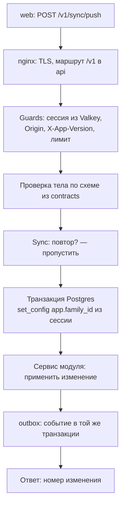
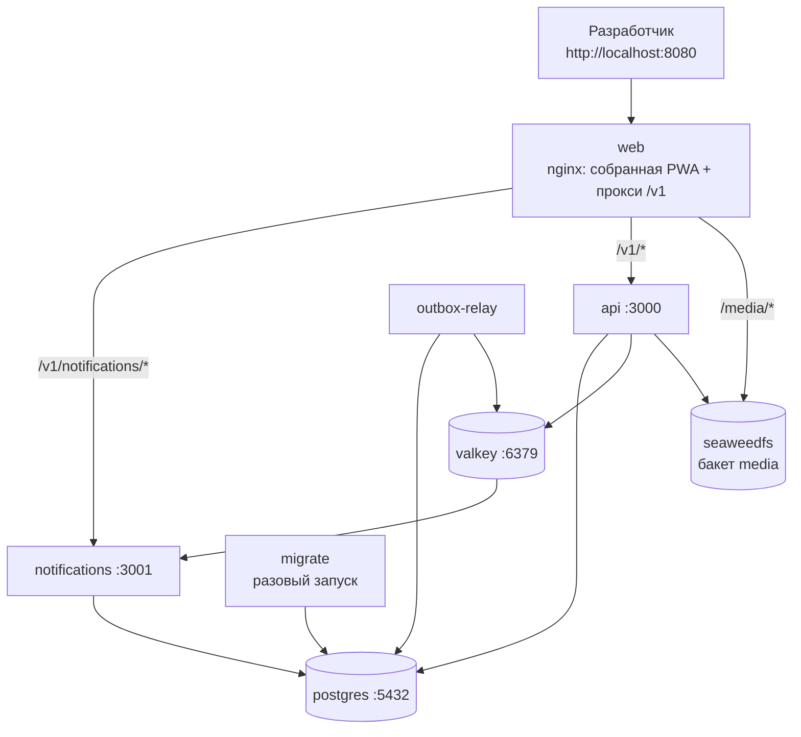

# ADR-005. Архитектура и стек бэка

**Статус:** предложен, 18.10.2026.

Подробно про бэк: какие процессы работают, как устроен код внутри `api` и `notifications`, как
проходит запрос, где лежат данные, какие настройки нужны и как поднять всё локально. Общая
картина и связь с фронтом — ADR-001.

## Контекст

- Доменное ядро — модульный монолит, уведомления — отдельный сервис с первого дня (ADR-001).
- Нагрузка — единицы запросов в секунду. Структура кода важнее производительности.
- Проект — полигон: нужна ясная граница модулей, события между сервисами и окружение, которое
  локально выглядит так же, как на VM контура.
- У разработчика локально Podman, на VM — Docker. Compose-файл должен работать с обоими.

## Решение

### 1. Стек

| Что | Берём | Почему |
|---|---|---|
| Язык | TypeScript strict | Как во фронте, общие схемы и правила кода |
| Фреймворк | NestJS на адаптере Fastify | Модули, внедрение зависимостей, guards, лимит запросов и OpenAPI из коробки — готовая форма для модульного монолита |
| Проверка данных и OpenAPI | zod через `nestjs-zod` | Схемы из `packages/contracts` проверяют запросы и дают описание API |
| База | PostgreSQL | Главная копия данных, Row-Level Security, восстановление на момент времени |
| Работа с базой | Prisma и Prisma Migrate | Типы из схемы, понятные миграции; политики RLS — SQL в тех же миграциях |
| Сессии, события, очереди | Valkey: ключи с TTL, Streams, BullMQ | Брокер с первого дня, лицензия без условий |
| Вход | `openid-client` для Google и Apple, свои адаптеры для Яндекс ID и VK ID, `@simplewebauthn/server` для Face ID | Храним только хеш идентификатора и открытый ключ passkey, без email и профиля (ADR-008) |
| Логи | pino, JSON в stdout | Без персональных данных: id вместо имён, без IP |
| Тесты | vitest, интеграционные — на настоящем Postgres из Compose | Как во фронте; изоляцию семей проверяем на живой базе |

### 2. Процессы

| Процесс | Образ | Что делает |
|---|---|---|
| `api` | `apps/api` | HTTP API на порту 3000: вход, синхронизация, бэкап, meta |
| `outbox-relay` | `apps/api`, команда `relay` | Забирает неотправленные события из `outbox` пачками до 100, кладёт в Stream `events`, помечает отправленными; пока есть что отправлять — сразу следующую пачку, иначе пауза в секунду (ADR-006) |
| `notifications` | `apps/notifications` | В одном процессе: читатель событий своей группой, обработчик задач BullMQ и HTTP на порту 3001 для `/v1/notifications/*` |
| `migrate` | `apps/api` | Разовый запуск перед деплоем: миграции схем `core` и `notifications`, затем записи ченджлога в базу (ADR-002) |

### 3. Структура `apps/api`

```
apps/api/
  Dockerfile
  prisma/
    schema.prisma          таблицы схемы core
    migrations/            миграции Prisma и SQL с политиками RLS
  src/
    main.ts                запуск HTTP
    relay.ts               запуск outbox-relay
    app.module.ts          сборка модулей
    platform/              общее для всех модулей, без предметной логики
      config/              переменные окружения, проверка zod при старте
      database/            Prisma Client и транзакция с family_id
      valkey/              подключение к Valkey
      outbox/              запись событий и цикл relay
      storage/             S3: подписанные ссылки на загрузку и удаление файлов
      http/                guards: сессия, Origin, X-App-Version, лимит запросов
      logger/              pino
    modules/
      identity/  family/  children/  tasks/  rewards/
      ledger/  settings/  sync/  backup/  media/  meta/
  test/                    интеграционные тесты
```

Модуль на примере `tasks`:

```
modules/tasks/
  index.ts             публичный интерфейс: модуль Nest и сервис для других модулей
  tasks.module.ts
  tasks.service.ts     применение изменений: создать, поменять поля, в архив, вернуть
  tasks.repository.ts  запросы Prisma только к своим таблицам
  lib/                 чистые функции, например периоды активности
```

Правила — те же, что FSD во фронте:

- Другой модуль импортирует только `index.ts`. Пути вида `modules/tasks/tasks.repository` снаружи
  запрещены.
- Репозиторий модуля трогает только свои таблицы. Что нужно из чужого модуля — через его сервис
  или событие.
- Событие сервис пишет в `outbox` в той же транзакции, что и данные.
- `platform` не знает про модули, модули знают про `platform`.

| Модуль | Отвечает за | HTTP |
|---|---|---|
| Identity | Аккаунты провайдеров, passkey, сессии, устройства, dev-вход, удаление аккаунта | `/v1/auth/*`, `/v1/me`, `/v1/dev/login` |
| Family | Семья, часовой пояс, членство, удаление семьи | через Sync, `DELETE /v1/family` |
| Children | Дети, цели | через Sync |
| Tasks | Задачи, квесты, периоды активности | через Sync |
| Rewards | Награды, варианты, видимость | через Sync |
| Ledger | Отметки и покупки со снимками цены | через Sync |
| Settings | Бонус, этапы серии, хеш PIN. Язык — настройка устройства, на сервер не едет (ADR-003) | через Sync |
| Sync | Приём изменений, защита от повторов, выдача изменений по номеру | `/v1/sync/*` |
| Backup | Экспорт данных семьи в формате бэкапа | `/v1/backup/export` |
| Media | Подписанные ссылки на загрузку картинок вариантов, очистка непривязанных файлов (ADR-009) | `/v1/images` |
| Meta | Версия сервера, `minClientVersion`, коммит, ченджлог (ADR-002) | `/v1/meta`, `/v1/changelog` |

### 4. HTTP API первой версии

| Метод и путь | Что делает |
|---|---|
| `GET /v1/meta` | Версия сервера, `minClientVersion`, коммит, включённые способы входа, включён ли dev-вход |
| `GET /v1/changelog` | Ченджлог на трёх языках, без сессии (ADR-002) |
| `GET /v1/auth/:provider/start` | Начало входа: редирект к провайдеру с PKCE |
| `GET /v1/auth/:provider/callback` | Возврат от провайдера: найти или создать аккаунт, поставить cookie |
| `POST /v1/auth/passkey/*`, `DELETE /v1/auth/passkey/:id` | Face ID: создать passkey, войти или проверить, отключить (ADR-008) |
| `POST /v1/auth/logout` | Выход: удалить сессию |
| `GET /v1/me` | Текущий пользователь, семья и устройство |
| `DELETE /v1/me` | Удалить аккаунт, а с ним и семью (ADR-009) |
| `DELETE /v1/family` | Удалить семью и все её данные (ADR-009) |
| `POST /v1/dev/login` | Только при `DEV_LOGIN=true`: вход по имени без провайдера |
| `POST /v1/sync/push` | Пачка изменений: онлайн — одно, после офлайна — вся очередь |
| `GET /v1/sync/pull?since=N` | Изменения семьи с номера `N` |
| `GET /v1/sync/snapshot` | Всё состояние семьи — для нового устройства |
| `GET /v1/backup/export` | Экспорт данных семьи в формате бэкапа |
| `POST /v1/images` | Подписанная ссылка на загрузку одной картинки варианта (ADR-009) |

Все записи идут через `POST /v1/sync/push` — и онлайн, и после офлайна. Путь один, поэтому защита
от повторов, нумерация и разбор конфликтов работают одинаково. Sync по типу изменения вызывает
сервис нужного модуля через его `index.ts`.

Изменение и ответ описаны в `packages/contracts`:

- изменение — `{ mutationId, type, schemaVersion, entityId, fields }`; для каталога и настроек
  `fields` — только изменённые поля;
- ответ — принятые изменения с присвоенным номером и отклонённые с причиной. Отклоняются только
  некорректные данные, например отметка несуществующему ребёнку.

### 5. Путь запроса



- `family_id` берётся только из сессии и выставляется первой командой транзакции. Тело запроса
  его не задаёт.
- Если сессии нет — `401`, версия клиента ниже минимума — `426`, тело не прошло схему — `400` с
  перечнем полей.

### 6. Данные

- Одна база Postgres на контур, две схемы: `core` — данные `api`, `notifications` — данные
  уведомлений. У каждого сервиса своя Prisma-схема и свои миграции.
- Три роли базы: `migrator` владеет таблицами и запускает миграции; `app_core` работает со
  схемой `core`; `app_notifications` — только со схемой `notifications`. Роли приложений не
  владеют таблицами и не обходят RLS.
- Таблицы `core` повторяют нынешние таблицы Dexie и добавляют служебные: `users`,
  `auth_accounts`, `families`, `memberships`, `devices`, `children`, `tasks`, `rewards`,
  `reward_variants`, `settings`, `completions`, `spends`, `outbox`, `processed_mutations`. Серии
  и баланс не хранятся, они считаются из истории.
- У каждой строки семьи: `family_id`, номер последнего изменения, время создания и изменения,
  пометка удаления или архива. Отметки и покупки не удаляются, а помечаются удалёнными.
- RLS на каждой таблице семьи: строка видна, только если её `family_id` совпадает с
  `app.family_id` текущей транзакции. Подробно — ADR-007.

### 7. Структура `apps/notifications` и `packages/contracts`

```
apps/notifications/
  Dockerfile
  prisma/schema.prisma   схема notifications: подписки, расписания, лента, журнал
  src/
    main.ts              HTTP, читатель событий и обработчик задач
    platform/            config, database, valkey, сессия, logger
    consumers/           обработчики событий по типам
    jobs/                задачи BullMQ: напоминания
    http/                /v1/notifications/*

packages/contracts/
  src/
    api/                 схемы запросов и ответов: meta, auth, sync, backup
    sync/                конверт изменения и типы изменений
    events/              конверт события и схемы событий
    index.ts
```

Первая версия `notifications` — каркас: читает Stream `events` группой `notifications` и пишет
события в лог. Так цепочка событий обкатана до первого настоящего уведомления.

### 8. Настройки

Все настройки — переменные окружения. При старте сервис проверяет их zod-схемой и не запускается,
если чего-то не хватает.

| Переменная | Кто читает | Что это |
|---|---|---|
| `DATABASE_URL` | `api`, `notifications` | Подключение своей роли к Postgres |
| `MIGRATOR_DATABASE_URL` | `migrate` | Подключение роли `migrator` |
| `VALKEY_URL` | все | Подключение к Valkey с паролем |
| `PUBLIC_ORIGIN` | `api`, `notifications` | Адрес фронта для проверки `Origin`, CORS и редиректов после входа |
| `REGION` | все | Контур: `eu` или `ru` |
| `AUTH_PROVIDERS` | `api` | Включённые способы входа через запятую: `google`, `yandex`, `vk`, `apple` |
| `AUTH_PEPPER` | `api` | Секрет для хеша идентификатора провайдера; не меняется никогда |
| `GOOGLE_CLIENT_ID`, `GOOGLE_CLIENT_SECRET` | `api` | Вход через Google |
| `YANDEX_CLIENT_ID`, `YANDEX_CLIENT_SECRET`, `VK_CLIENT_ID`, `VK_CLIENT_SECRET` | `api` | Вход через Яндекс ID и VK ID |
| `APPLE_CLIENT_ID`, `APPLE_TEAM_ID`, `APPLE_KEY_ID`, `APPLE_PRIVATE_KEY` | `api` | Вход через Apple: из ключа `api` подписывает секрет клиента |
| `WEBAUTHN_RP_ID` | `api` | Домен, к которому привязаны passkey; локально `localhost` |
| `MIN_CLIENT_VERSION` | `api`, `notifications` | Минимальная версия PWA |
| `DEV_LOGIN` | `api` | `true` только локально: вход без провайдера |
| `VAPID_PUBLIC_KEY`, `VAPID_PRIVATE_KEY`, `VAPID_SUBJECT` | `notifications` | Web Push, позже (ADR-010) |
| `S3_ENDPOINT`, `S3_PUBLIC_URL`, `S3_BUCKET`, `S3_ACCESS_KEY_ID`, `S3_SECRET_ACCESS_KEY` | `api` | Объектное хранилище картинок вариантов (ADR-009) |

### 9. Локальное окружение

Весь контур поднимается одной командой — Docker Compose или Podman. Состав тот же, что на VM;
нет только TLS и внешнего CDN.



| Сервис | Образ | Порт на машине | Заметки |
|---|---|---|---|
| `postgres` | `docker.io/library/postgres:17-alpine` | `127.0.0.1:5432` | Том `pgdata`; скрипт при первом старте создаёт роли и схемы |
| `valkey` | `docker.io/valkey/valkey:8-alpine` | `127.0.0.1:6380` | Пароль, AOF раз в секунду, `noeviction`; том `valkeydata`. На машине 6380: 6379 часто занят другим Redis |
| `migrate` | сборка `apps/api` | — | Миграции `core` и `notifications`, затем выходит |
| `api` | сборка `apps/api` | — | Стартует после `migrate` |
| `outbox-relay` | сборка `apps/api` | — | Команда `relay` |
| `notifications` | сборка `apps/notifications` | — | Позже — своя роль в Postgres и ключи VAPID (ADR-010) |
| `seaweedfs` | `docker.io/chrislusf/seaweedfs` | — | S3-совместимое хранилище картинок вариантов, бакет `media`, том `mediadata` (ADR-009) |
| `web` | сборка `apps/web` | `127.0.0.1:8080` | nginx отдаёт собранную PWA и проксирует `/v1` — фронт и API на одном адресе, cookie работают как на проде |

Файлы:

- `compose.yaml` в корне репозитория;
- `infra/nginx/local.conf` — маршруты `/v1/notifications/*`, `/v1/*` и `/media/*`;
- `infra/postgres/init.sh` — роли `migrator`, `app_core`, `app_notifications` и схемы; пароли берёт из
  переменных окружения, поэтому скрипт годится и для VM; `migrator` получает право `CREATE` на
  базу — без него Prisma не применяет миграцию со схемой;
- `.env.example` с локальными значениями и портами на машине; копия `.env` в git не попадает.

npm 11.19 в образе `node:24-alpine` не запускает install-скрипты пакетов без разрешения. Разрешения
для Prisma и esbuild записаны в `allowScripts` корневого `package.json` с точной версией.

Чтобы один и тот же файл работал в Docker и Podman:

- образы записаны полным именем с реестром (`docker.io/...`): Podman не угадывает короткие имена;
- только стандартные возможности Compose: сервисы, тома, сети, `depends_on`, `healthcheck`, без
  расширений Docker;
- `podman compose` вызывает docker-compose, поэтому условия в `depends_on` работают так же, как в
  Docker. Если в другой установке он не дождётся `migrate`, миграции запускаются отдельной
  командой перед `up`.

Команды:

| Что | Podman | Docker |
|---|---|---|
| Поднять всё | `podman compose up -d --build` | `docker compose up -d --build` |
| Миграции вручную | `podman compose run --rm migrate` | `docker compose run --rm migrate` |
| Логи `api` | `podman compose logs -f api` | `docker compose logs -f api` |
| Только база и Valkey | `podman compose up -d postgres valkey` | `docker compose up -d postgres valkey` |
| Снести вместе с данными | `podman compose down -v` | `docker compose down -v` |

На macOS Podman работает в виртуальной машине: `podman machine init` и `podman machine start` один
раз, машине нужно от 4 ГБ памяти.

Как разрабатывать:

- **Весь контур** — `compose up`, приложение на `http://localhost:8080`.
- **Бэк с перезапуском при правках** — в контейнерах только `postgres` и `valkey`, `api` или
  `notifications` запускаются на машине через `npm run dev -w apps/api`.
- **Фронт с горячей перезагрузкой** — `npm run dev -w apps/web`; Vite проксирует `/v1` на
  `http://localhost:8080`, поэтому фронт и API для браузера остаются на одном адресе.
- **Вход без провайдера.** Локально у провайдеров нет зарегистрированного приложения, поэтому при
  `DEV_LOGIN=true` есть `POST /v1/dev/login` с именем: одно имя — одна и та же тестовая семья,
  разные имена — разные семьи. Если `DEV_LOGIN` включён вместе с `NODE_ENV=production`, `api`
  отказывается стартовать. Face ID (passkey) работает на `localhost` без провайдера.

## Рассмотренные варианты

| Вопрос | Варианты | Почему выбрали так |
|---|---|---|
| Фреймворк | Hono с `@hono/zod-openapi`; Express без фреймворка; **NestJS** | Hono легче, но границы модулей пришлось бы держать только дисциплиной; в Nest модули и DI — часть фреймворка |
| Работа с базой | Drizzle; Kysely; TypeORM; **Prisma** | Drizzle встраивает RLS, но Prisma распространённее и с более зрелыми миграциями; RLS пишем SQL-миграциями сами |
| Путь записи | Отдельные REST-эндпоинты на каждую сущность; **все записи через `sync/push`** | Онлайн и офлайн идут одним кодом: повторы, нумерация и конфликты разбираются в одном месте |
| Схема базы уведомлений | Одна Prisma-схема на оба сервиса; **своя у каждого сервиса** | Граница сервиса видна в коде: `notifications` не может прочитать таблицы ядра |
| Локальная разработка | Только контейнеры; только процессы на машине; **весь контур в контейнерах, разработка части — на машине** | Контур проверяется так же, как на проде, а правки идут без пересборки образов |

## Последствия

- Появляются `apps/api`, `apps/notifications`, `packages/contracts`, `compose.yaml`,
  `infra/nginx/local.conf`, `infra/postgres/init.sh` и `.env.example`. Нынешнее приложение
  переезжает в `apps/web` (ADR-001). Каркас сделан в ветке `feat/backend-0.6`, контур проверен в
  Podman: событие из `outbox` доходит до `notifications`.
- В `packages/contracts` переезжают схемы, общие для фронта и бэка. Схемы чтения IndexedDB
  остаются во фронте: они снисходительны к старым записям, а сервер принимает только текущий
  формат.
- Каждая таблица семьи получает политику RLS в миграции, и для каждой есть тест, что чужая семья
  её не видит.
- Для локального запуска нужны Docker или Podman и Node той же версии, что в CI.
- Вход через провайдеров и всё на iPad проверяется только по HTTPS: на домене контура или через
  туннель. Локально работают `DEV_LOGIN` и passkey в браузере на машине.
