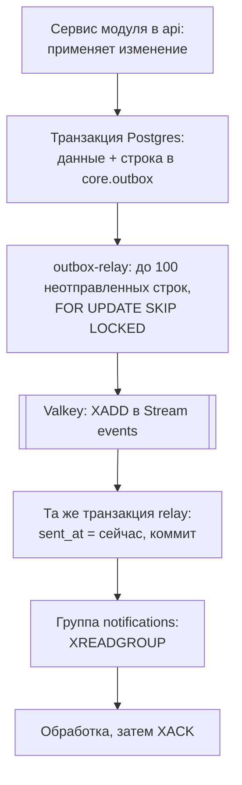

# ADR-006. События и очереди

**Статус:** предложен, 20.10.2026.

Как другие сервисы узнают об изменениях данных, почему событие не теряется, как устроены
потребители и где живут отложенные задачи. Общая картина — ADR-001, §6, процессы — ADR-005.

## Контекст

- Нагрузки для брокера нет. На нашем объёме хватило бы одного Postgres: очереди на pg-boss или
  Graphile Worker, события через таблицу.
- Брокер закладываем с первого дня осознанно: ради масштабирования и чтобы отработать событийную
  архитектуру с отдельными потребителями на настоящем проекте (ADR-001).
- Первый потребитель — `notifications` (ADR-010), позже — analytics.
- Записать данные в Postgres и событие в брокер одной транзакцией нельзя: между двумя записями
  процесс может упасть.
- Valkey в контуре нужен и так — для сессий и лимитов запросов (ADR-008).
- Каркас цепочки уже построен в ветке `feat/backend-0.6` и проверен в Podman: событие из `outbox`
  доходит до `notifications`.

## Решение

### 1. Брокер — Valkey

- Valkey — форк Redis 7.2.4 в Linux Foundation с тем же протоколом и командами: Streams, ключи со
  сроком жизни, Lua и BullMQ работают без изменений.
- Почему не Redis: у Redis с 7.4 лицензия RSAL/SSPL, с 8.0 ещё и AGPL — бесплатно, но с
  условиями. У Valkey — BSD-3 без условий, а managed-сервисы Yandex Cloud и OVHcloud предлагают
  именно Valkey, поэтому переезд в облако ничего не меняет.
- Почему не Kafka: отдельный кластер и его эксплуатация без всякой выгоды на нашем объёме.
- Контейнер на той же VM, что и `api`, наружу не открыт, доступ по паролю.
- Сохранение на диск (AOF) раз в секунду: потоки и задачи переживают перезапуск.
- Лимит памяти (локально 256 МБ) и политика `noeviction`: при нехватке памяти Valkey отказывает
  в записи, а не выкидывает ключи. Этого требует BullMQ.
- Бэкапов Valkey нет. Главная копия данных — Postgres: события лежат в `outbox`, напоминания
  пересоздаются из расписаний, пропавшая сессия — это повторный вход.
- Совместимость с Redis держим на случай переезда: только команды общей базы 7.2, без модулей
  Redis 8 (JSON, поиск). Тогда переезд — это смена адреса подключения.

| Что | Как в Valkey |
|---|---|
| События между сервисами | Stream `events` и группы потребителей |
| Отложенные и повторяющиеся задачи | BullMQ внутри `notifications` |
| Сессии | Ключи со сроком жизни (ADR-008) |
| Лимиты запросов | Счётчики со сроком жизни (ADR-008) |

### 2. Как событие не теряется — outbox

Outbox — таблица исходящих событий в той же базе, что и данные. Событие пишется в неё той же
транзакцией, что и само изменение, а отдельный процесс перекладывает его в Valkey.

Как это сделано в коде:

- Модуль пишет событие через `OutboxService.record(tx, event)` тем же клиентом транзакции, что и
  данные. Откатилась транзакция — нет ни данных, ни события.
- Таблица `core.outbox`: `id` (он же `eventId`), `type`, `version`, `family_id`, `payload`,
  `occurred_at` — время записи, `sent_at` — когда отправлено. Индекс по `sent_at` и `occurred_at`.
- `outbox-relay` — отдельный процесс из образа `api` (`node dist/relay.js`). В цикле он открывает
  транзакцию, берёт до 100 неотправленных строк по порядку `occurred_at`, кладёт их в Stream
  `events` одним пакетом (поле `event` — JSON конверта), ставит `sent_at` и фиксирует транзакцию.
- Если хоть одно событие пакета не легло в Valkey, транзакция откатывается: строки остаются
  неотправленными и уйдут в следующем круге.
- Нашлись строки — следующий круг сразу, пусто — пауза в одну секунду. По `SIGTERM` relay
  дорабатывает круг и выходит.
- `FOR UPDATE SKIP LOCKED` значит: строки, которые уже взял другой relay, пропускаются. Второй
  экземпляр можно запустить без двойной отправки из-за гонки.

**Доставка «хотя бы один раз».** Если relay упал после `XADD`, но до коммита, строки остались
неотправленными и событие уйдёт повторно. Поэтому любой потребитель обязан узнавать повторы
(раздел 5).

**Порядок.** Relay отправляет по `occurred_at`, но транзакция, начатая раньше, может
зафиксироваться позже. Строгого порядка событий нет. Потребитель, которому важен порядок событий
одной записи, сравнивает `occurredAt`.

`outbox` заодно — журнал всех событий для analytics, пока нет ClickHouse. Отправленные строки не
удаляем.

### 3. Конверт и схемы

- Конверт: `{ eventId, type, version, occurredAt, familyId, payload }` — zod-схема
  `eventEnvelopeSchema` в `packages/contracts`. `familyId` пустой у событий, которые не относятся
  к семье.
- Тип — «сущность.что произошло» в прошедшем времени: `completion.recorded`.
- У каждого типа и версии своя zod-схема `payload` в `packages/contracts/src/events`. `api`
  проверяет событие по ней перед записью в `outbox`, потребитель — при чтении.
- В `payload` только id, числа и даты. Имён, PIN и всего личного там нет (ADR-009): события
  лежат в Valkey и в журнале. Что потребителю нужно сверх id, он берёт из прошлых событий или не
  показывает.

### 4. Каталог первой версии

| Тип | Версия | `payload` | Когда пишется |
|---|---|---|---|
| `family.created` | 1 | `timezone` | Семья создана при первом входе (ADR-008) |
| `family.updated` | 1 | `timezone` | Сменился часовой пояс семьи |
| `family.deleted` | 1 | — | Семья удалена (ADR-009). Потребители удаляют всё, что хранят о ней |
| `completion.recorded` | 1 | `completionId`, `childId`, `taskId`, `day`, `points` | Отметка принята |
| `completion.removed` | 1 | `completionId`, `childId`, `taskId`, `day` | Отметку сняли |
| `spend.recorded` | 1 | `spendId`, `childId`, `rewardId`, `cost`, `source` | Покупка награды или приз серии |

- `familyId` — в конверте, не в `payload`.
- `day` — день отметки в формате `YYYY-MM-DD` по часовому поясу семьи (ADR-004).
- `source` — `purchase` или `streak`, как в таблице `spends` (ADR-007).
- Правки каталога (дети, задачи, награды) событий пока не пишут: их не ждёт ни один потребитель.
  Событие появляется вместе с первым, кому оно нужно.
- События пишутся на каждое применённое изменение, в том числе при первой выгрузке данных гостя
  после входа (ADR-004). Тогда приходят отметки за прошлые дни; потребителю, которому важно только
  свежее, хватает поля `day`.

### 5. Потребители

Группа потребителей (consumer group) — способ читать поток: Valkey помнит, до какого сообщения
группа дочитала и какие сообщения выданы, но ещё не подтверждены. Разные группы получают все
сообщения каждая, экземпляры одной группы делят сообщения между собой.

- У каждого сервиса-потребителя своя группа: сейчас `notifications`, позже `analytics`. Каждая
  читает в своём темпе, упавший потребитель не мешает остальным.
- Потребитель не ходит в `api` и не читает таблицы `core`: всё, что ему нужно, приходит событиями
  (ADR-001).

Что уже сделано в `notifications`:

- При старте группа создаётся с начала потока (`XGROUP CREATE events notifications 0 MKSTREAM`);
  если она уже есть — продолжает с того места, где остановилась.
- Имя экземпляра — `CONSUMER_NAME`, по умолчанию имя хоста контейнера.
- Чтение `XREADGROUP` по 10 сообщений, ожидание новых — до 2 секунд.
- Каждое сообщение проверяется по схеме конверта: корректное пишется в лог, некорректное —
  предупреждением в лог. Оба подтверждаются (`XACK`).

Правила, которые вводим с первым настоящим обработчиком (ADR-010):

| Правило | Как |
|---|---|
| Подтверждаем только после успешной обработки | Ошибка — сообщение остаётся выданным, но не подтверждённым |
| Зависшие сообщения забираем | Раз в минуту экземпляр забирает себе сообщения, которые висят без подтверждения дольше 5 минут (`XAUTOCLAIM`): например, другой экземпляр упал посреди обработки |
| Необрабатываемые — в отдельный поток | После 5 неудачных попыток сообщение уходит в Stream `events:dead` с причиной и подтверждается в основном. Туда же — некорректный конверт и версия типа, которую потребитель ещё не знает. Разбираем руками |
| Повтор не применяется дважды | Потребитель хранит обработанные `eventId` в таблице `processed_events` своей схемы и пишет туда в той же транзакции, что и результат. Повтор — пропустить и подтвердить |
| Незнакомый тип — не ошибка | Подтверждаем и пропускаем: потребитель не обязан знать все события |

### 6. Длина потока

- Подтверждённые сообщения остаются в потоке. Без обрезки поток растёт, а при `noeviction` Valkey
  начнёт отказывать в записи, когда кончится память.
- Relay при записи обрезает поток по возрасту: `XADD events MINID ~ <сейчас минус 7 дней>`. id
  сообщения в Stream начинается со времени в миллисекундах, поэтому порог — это время.
- Неделя переживает любой простой потребителя. Полная история — в `outbox`.
- Новая группа, заведённая позже, получает из потока не больше недели; всё старее берёт из
  `outbox`.

### 7. Версии событий

- Новые поля только добавляются в рамках той же `version`, и потребитель не обязан их знать.
- Ломающее изменение — переименовать, убрать поле или поменять смысл — новая `version`. Какое-то
  время `api` пишет обе версии, пока все потребители не перейдут на новую. Старую перестаём писать
  отдельным релизом.
- Схемы всех действующих версий лежат в `packages/contracts`.

### 8. Отложенные и повторяющиеся задачи — BullMQ

BullMQ — очередь задач поверх Valkey: запуск в нужный момент, повтор по расписанию, повторные
попытки с нарастающей паузой.

- Задачи «сделать в 18:00 по времени семьи» и «повторять каждый день» — BullMQ. Первые применения
  — напоминания и повторные попытки отправить push (ADR-010).
- BullMQ живёт внутри `notifications` (ADR-005), `api` его не использует.
- Источник правды для расписаний — таблицы в схеме `notifications`. Задачи BullMQ из них
  пересоздаются, поэтому Valkey обходится без бэкапов.
- Streams и BullMQ не смешиваем: Stream говорит «что случилось» и отложенного запуска не умеет,
  BullMQ — «что сделать и когда».
- В каркасе BullMQ ещё не подключён.

### 9. Локально и наблюдение

- Valkey в `compose.yaml` настроен так же, как на VM: пароль, AOF раз в секунду, `noeviction`. На
  машине — порт 6380.
- Посмотреть поток и группы:

| Что | Команда |
|---|---|
| Последние события | `podman compose exec valkey valkey-cli -a <пароль> XREVRANGE events + - COUNT 10` |
| Группы и отставание | `podman compose exec valkey valkey-cli -a <пароль> XINFO GROUPS events` |
| Неотправленное в Postgres | `SELECT count(*) FROM core.outbox WHERE sent_at IS NULL` |

- На VM следим за длиной потока, отставанием групп (`lag` в `XINFO GROUPS`), числом
  неотправленных строк `outbox` и памятью Valkey.

## Рассмотренные варианты

| Вопрос | Варианты | Почему выбрали так |
|---|---|---|
| Брокер | Без брокера, на Postgres (pg-boss, Graphile Worker); Kafka; RabbitMQ; **Valkey Streams** | Postgres бы хватило, но цель — событийная архитектура с отдельными потребителями. Kafka и RabbitMQ — ещё один сервис без выгоды, а Valkey в контуре и так нужен |
| Valkey или Redis | Redis в контейнере; managed-сервис; **Valkey в контейнере** | Бесплатно, лицензия без условий, в облаках RU и EU managed-вариант — тоже Valkey |
| Как не потерять событие | Писать в Valkey прямо из `api` после коммита; **outbox и relay** | После коммита процесс может упасть — событие потеряется; до коммита — событие появится без данных |
| Где помнить обработанные `eventId` | Множество в Valkey со сроком жизни; **таблица в базе потребителя** | Отметка «обработано» в одной транзакции с результатом: повтор не проскочит, а результат не потеряется |
| Длина потока | Не обрезать; по числу сообщений; **по возрасту, неделя** | Память ограничена, а неделя переживает любой простой потребителя; полная история — в `outbox` |
| Отложенные задачи | Свои таймеры поверх Streams; cron в контейнере; **BullMQ** | Готовые отложенный запуск, расписания и повторные попытки поверх того же Valkey |

## Последствия

- Модуль, у изменения которого есть событие из каталога, пишет его через `OutboxService` в той же
  транзакции, что и данные.
- В `packages/contracts` появляются схемы `payload` для каждого типа и версии; `api` проверяет
  событие перед записью, потребитель — при чтении.
- Relay получает обрезку потока по возрасту.
- Потребитель `notifications` с первым настоящим обработчиком получает подтверждение после
  успеха, забор зависших, поток `events:dead` и таблицу `processed_events` (ADR-010).
- BullMQ подключается в `notifications` вместе с напоминаниями.
- Первая выгрузка данных гостя рождает события об отметках за прошлые дни — потребители смотрят на
  `day` (ADR-010).
- `outbox` растёт как журнал; срок хранения решаем вместе с analytics. Что делать со строками
  удалённой семьи — ADR-009.
