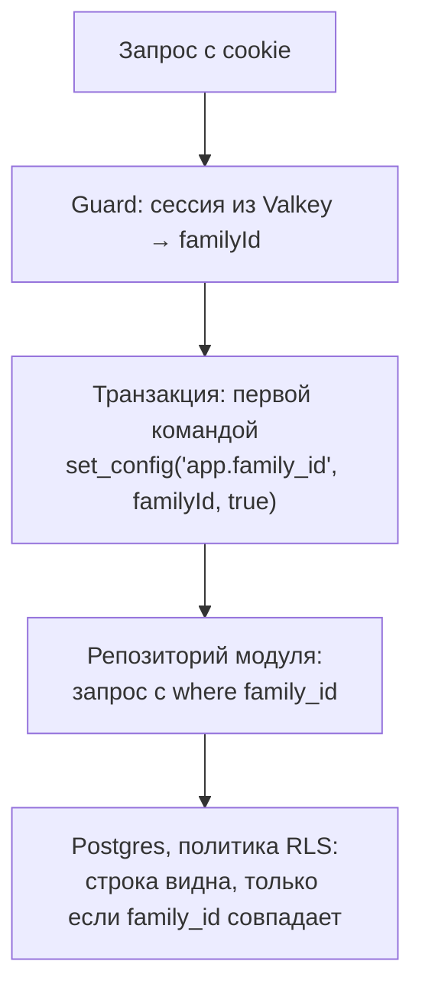

# ADR-007. Данные на сервере и изоляция семей

**Статус:** предложен, 19.10.2026.

Какие таблицы живут на сервере, какие служебные поля нужны синхронизации и как одна семья не
видит данные другой. Вход и сессии — ADR-008, правила синхронизации — ADR-004.

## Контекст

- Сейчас данные семьи — таблицы Dexie на устройстве: `children`, `tasks`, `rewards`,
  `rewardVariants`, `variantPhotos`, `settings`, `completions`, `spends`, `streaks`, `versionLog`.
- На сервере в одной базе контура лежат данные всех семей. Худшее, что может случиться, — одна
  семья увидит данные о чужих детях.
- Синхронизация сливает изменения по полям и выбирает более свежее (ADR-004). Для этого строкам
  нужны служебные поля.
- База — PostgreSQL, работа с ней — Prisma (ADR-005). Сейчас в схеме только `outbox`.

## Решение

### 1. Схемы и роли

- Одна база на контур, две схемы: `core` — данные `api`, `notifications` — данные уведомлений. У
  каждого сервиса своя Prisma-схема и свои миграции.
- Роли: `migrator` владеет таблицами и запускает миграции, `app_core` работает со схемой `core`,
  `app_notifications` — только со схемой `notifications`. Роли приложений не владеют таблицами и
  не имеют `BYPASSRLS`, поэтому политики защиты строк действуют на них всегда.

### 2. Аккаунты

Эти таблицы не принадлежат семье: при входе семья ещё неизвестна. Работает с ними только модуль
Identity.

| Таблица | Что хранит |
|---|---|
| `users` | Человек: id и время создания. Больше ничего |
| `auth_accounts` | Способ входа: провайдер, `HMAC(идентификатор, AUTH_PEPPER)`, пользователь. Пара «провайдер и хеш» уникальна |
| `passkeys` | Ключ Face ID: id ключа, открытый ключ, счётчик подписей, пользователь, время создания и последнего входа |
| `memberships` | Пользователь, семья и роль. Пока только `parent` и один родитель на семью |

Сессии живут в Valkey, а не в Postgres (ADR-008).

Ещё одна таблица без семьи — `changelog_entries`: записи ченджлога, которые `migrate` заливает
при выкатке (ADR-002). Её читает только `GET /v1/changelog`.

### 3. Данные семьи

| Таблица | Что хранит |
|---|---|
| `families` | Семья: часовой пояс, последний номер изменения |
| `devices` | Устройства семьи: пользователь, время создания и последнего визита |
| `children` | Имя, аватарка из набора (`avatar_id`), фигурка, порядок, цель |
| `tasks` | Задачи и квесты, периоды активности |
| `rewards`, `reward_variants` | Награды и их варианты. У варианта — ключ картинки в объектном хранилище |
| `settings` | Одна строка на семью: бонус, этапы серии, хеш и соль PIN |
| `completions` | Отметки. `points` — снимок цены; id вычисляется из ребёнка, задачи и дня |
| `spends` | Покупки и призы серии. `cost` и выбранный вариант — снимки, `source: purchase \| streak` |
| `processed_mutations` | id принятых изменений — повтор не применяется второй раз |
| `outbox` | События для Valkey Streams (ADR-006) |

На сервер не едут:

- `streaks` — серии считаются из истории;
- `versionLog` — какие версии видело это устройство, нужно только ему;
- `variantPhotos` — картинки вариантов лежат в объектном хранилище контура (ресерч `04`, §5);
- фото детей — вместо них аватарки из набора (ресерч `04`, §4).

### 4. Служебные поля

У каждой строки семьи:

| Поле | Зачем |
|---|---|
| `family_id` | Чья строка — по нему работает изоляция |
| `change_number` | Номер последнего изменения строки внутри семьи. Устройство забирает строки с номером больше своего (ADR-004) |
| `created_at`, `updated_at` | Когда строка появилась и когда её меняли |
| `field_changed_at` | У каталога и настроек — время изменения каждого поля по часам устройства. По нему сервер решает, чьё изменение поля свежее (ADR-004) |
| `archived_at` | У каталога: в архиве, а не удалено |
| `deleted_at` | У отметок и покупок: помечено удалённым |

Строки физически не удаляются — только при удалении всей семьи (ADR-009). Номер изменения выдаёт
`families.last_change_number` в той же транзакции, что и само изменение.

### 5. Изоляция семей

- **Первый рубеж — код.** `family_id` берётся только из сессии, тело запроса его не задаёт.
  Репозиторий модуля всегда фильтрует по нему.
- **Второй рубеж — Postgres.** На каждой таблице семьи включена защита строк (RLS) с политикой
  `family_id = current_setting('app.family_id', true)::uuid`. Флаг `true` в `set_config` держит
  значение только до конца транзакции.
- Если `app.family_id` не выставлен, запрос не видит ни одной строки — ошибка в коде даёт пустой
  ответ, а не чужие данные.
- В `platform/database` есть обёртка «транзакция семьи»: она открывает транзакцию и выставляет
  `family_id`. Репозитории получают Prisma только через неё.
- Новая семья создаётся в транзакции, где `app.family_id` уже выставлен на её новый id.
- На каждую таблицу семьи — интеграционный тест на Postgres из Compose: семья A не читает и не
  меняет строки семьи B, а без выставленной семьи не видно ничего.

### 6. Миграции

- Prisma Migrate. Политики RLS — SQL в тех же миграциях, что и таблицы.
- Сначала добавить, потом убрать: новая колонка или таблица выходит одним релизом, удаление старого —
  отдельным, когда его уже никто не читает. Во время выкатки старый и новый `api` работают с одной
  схемой.
- Миграции применяет разовый `migrate` до запуска `api` (ADR-005).

### 7. Инварианты

- `completions.points` и `spends.cost` — цена на момент события. Правка каталога историю не
  двигает.
- Приз за серию — строка `spends` с `source: 'streak'`, отдельной таблицы нет.
- Баланс и серии не хранятся, а считаются из истории. Минусовой баланс — тоже результат подсчёта.

## Рассмотренные варианты

| Вопрос | Варианты | Почему выбрали так |
|---|---|---|
| Изоляция | Только фильтр в коде; схема на семью; база на семью; **фильтр в коде и RLS** | Схема или база на семью — тысячи копий и миграций. Один фильтр в коде — одна ошибка до утечки |
| Работа с базой | Drizzle с встроенным RLS; Kysely; TypeORM; **Prisma** | Самая распространённая, зрелые миграции; политики RLS пишем SQL сами |
| Удаление | Удалять строки; **помечать** | Другое устройство должно узнать об удалении, а правка — уметь вернуть из архива |
| Время изменения | Одно `updated_at` на строку; **время на каждое поле** | Иначе правка имени на одном устройстве и цены на другом затрут друг друга |
| Сессии | Таблица в Postgres; **Valkey** | Сессия читается на каждом запросе и живёт со сроком — это работа для ключей с TTL |

## Последствия

- Первая миграция с таблицами аккаунтов и семьи и политиками RLS.
- В `platform/database` — обёртка транзакции семьи; без неё репозитории до Prisma не добираются.
- Интеграционные тесты на настоящем Postgres: отдельная команда, в CI — сервис Postgres.
- В Dexie: `avatarId` вместо фото, `deletedAt` у отметок и покупок, время изменения полей у
  каталога и настроек, вычисляемый id отметки.
- Удаление семьи и аккаунта — ADR-009.

## Как сделано, 27.10.2026

- Каталог, настройки и история пока лежат в одной таблице `core.records`: семья, вид записи
  (`children`, `tasks`, `rewards`, `rewardVariants`, `settings`, `completions`, `spends`), id,
  поля записи в JSON, время изменения каждого поля, номер изменения и `deleted_at`. Слияние по
  полям одинаковое для всех видов, а новый вид не требует миграции. Отдельные таблицы из раздела 3
  заводим, когда серверу понадобится своя логика над полями: отчёты, уведомления, проверка ссылок.
- `processed_mutations` и `records` — под той же политикой RLS `family_isolation`, тесты изоляции
  есть и для них.
- В Dexie `deletedAt` не появился: снятая отметка и откат покупки удаляют строку на устройстве, а
  сервер помечает запись удалённой и сообщает об этом другим устройствам.
- Аватарок вместо фото пока нет: фото детей остаются на устройстве и на сервер не едут.
