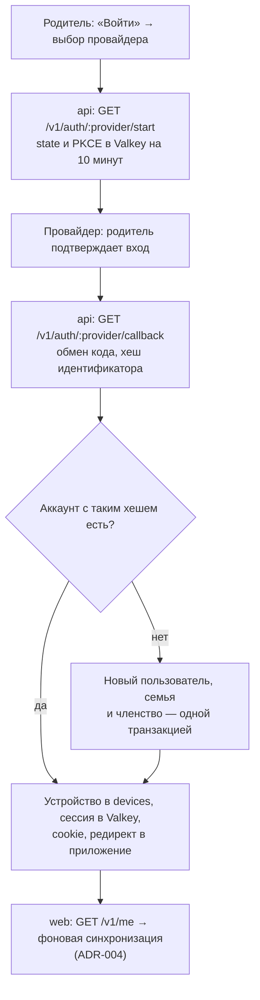

# ADR-008. Вход, сессии и защита API

**Статус:** предложен, 19.10.2026.

Как человек входит в аккаунт, как устройство остаётся в нём, как работают родрежим и PIN и как
API защищён от чужих запросов. Таблицы аккаунтов — ADR-007, синхронизация после входа — ADR-004.

## Контекст

- Сейчас аккаунтов нет. Данные лежат только на устройстве, родрежим закрыт PIN, PIN хранится в
  `settings` открытым текстом, сброс — пример для взрослых.
- Аккаунт нужен для одного: чтобы данные семьи жили на сервере и на всех её устройствах. Почта,
  имя и телефон родителя для этого не нужны (ресерч `04`).
- Обычная семья: общий планшет, на котором играют дети, и телефон родителя.
- На iOS у PWA с экрана «Домой» и у Safari разные cookie. Вход у провайдера может завершиться в
  Safari, и тогда сессия в PWA не попадает.
- Отправлять письма и SMS мы пока не умеем. Требования законов к способам входа (149-ФЗ для
  RU-контура) пока не учитываем — разбираем перед запуском RU-контура.

## Решение

### 1. Гость и аккаунт

- Вход пока необязателен. Без входа приложение работает как сейчас: данные только на устройстве,
  экспорт и импорт JSON, синхронизации нет.
- Пока человек не вошёл, в сайдбаре висит плашка: данные хранятся только на этом устройстве и не
  синхронизируются, пока вы не войдёте. На плашке — кнопка «Войти».
- Там, где API нет (GitHub Pages до переезда), приложение работает только гостем, плашки нет.
- Позже вход станет обязательным: гостевой режим убираем, остальное не меняется.
- Каждое устройство входит в аккаунт само. Второго родителя и ролей пока нет: в семье один
  аккаунт родителя, таблица `memberships` готова к приглашениям на будущее.

### 2. Способы входа

| Способ | Как работает | Заметки |
|---|---|---|
| Google | OIDC, код авторизации с PKCE, `openid-client` | Права `openid email`: без `email` или `profile` Google не отдаёт вход. Почту из ответа не сохраняем |
| Яндекс ID | OAuth 2.0 с PKCE, свой адаптер | Без прав `login:*`; ключ — `psuid` или `id` из `login.yandex.ru/info` |
| VK ID | OAuth 2.1 с PKCE, свой адаптер | `device_id` из колбэка нужен при обмене кода |
| Apple | OIDC, код авторизации, `openid-client` | Без прав `name` и `email` — тогда ответ приходит обычным редиректом. Нужен Apple Developer Program, $99 в год; секрет клиента — JWT, подписанный ключом Apple, обновляется раз в полгода. Подключаем последним |
| Face ID, Touch ID | Passkey (WebAuthn), `@simplewebauthn/server` и `@simplewebauthn/browser` | Только после первого входа через провайдера, раздел 4 |

- Включённые способы задаёт переменная `AUTH_PROVIDERS`, а не регион. Перед запуском RU-контура
  выключаем там то, что не разрешает закон.
- Своих паролей нет.
- Вход по почте кодом — позже, когда появится отправка писем. Человек вводит почту, сервер ищет
  аккаунт по её хешу и отправляет код на введённый адрес; в базе остаётся только хеш. SMS — тоже
  позже.
- От провайдера храним только `HMAC(идентификатор, AUTH_PEPPER)`. Почту, имя, аватар и токены
  провайдера не храним: после входа к API провайдера мы больше не ходим.
- Один и тот же человек через Google и через Яндекс — два разных аккаунта. Связывать способы входа
  между собой пока нельзя, кроме passkey: он всегда добавляется к уже открытому аккаунту.

### 3. Вход через провайдера

- `state` и PKCE-верификатор одноразовые и живут в Valkey 10 минут.
- `state` ещё и привязан к браузеру: `start` кладёт его в httpOnly-cookie `lbd_auth_state` на
  `/v1/auth` на те же 10 минут, колбэк сверяет её со `state` из адреса и стирает. Без этого чужой
  колбэк, подсунутый ссылкой, открыл бы в браузере жертвы чужой аккаунт, и её гостевые данные ушли
  бы в чужую семью.
- Повторный вход тем же способом на любом устройстве приводит в ту же семью.
- Данные гостя на устройстве после входа уходят на сервер в фоне и сливаются с данными семьи без
  вопросов — ADR-004.
- **iOS.** До работы над фронтом проверяем на реальном iPad, возвращается ли вход провайдера в PWA
  с экрана «Домой». Если нет — передача входа кодом: вход завершился в Safari, сервер показывает
  код из шести цифр, который живёт минуту, родитель вводит его в PWA, и PWA получает свою сессию.
  У passkey этой проблемы нет: проверка идёт внутри приложения, без перехода на сайт провайдера.

### 4. Face ID и Touch ID — passkey

- Passkey — ключ, который хранит устройство. Вход подтверждается Face ID, Touch ID или кодом
  устройства. Сервер хранит только открытый ключ, id ключа и счётчик подписей.
- После первого входа через провайдера приложение предлагает «Входить по Face ID» и создаёт
  passkey для этого аккаунта. Отключается в настройках.
- Вход по passkey: на экране входа «Войти по Face ID» — система сама показывает ключи для нашего
  сайта, вводить ничего не нужно.
- Passkey синхронизируется через iCloud Keychain или Google Password Manager. На другом устройстве
  того же человека вход — тоже по Face ID, без провайдера.
- Аккаунт только с passkey не создаём: если ключ не синхронизировался и устройства потеряны,
  восстановить такой аккаунт нечем.
- Passkey привязан к домену приложения (`WEBAUTHN_RP_ID`). Локально — `localhost`, браузер на машине
  считает его безопасным адресом. На iPad — только через HTTPS: туннель или домен.
- В Safari passkey работают с iOS 16. Работают ли они в PWA с экрана «Домой», проверяем на iPad
  вместе с входом провайдера.

### 5. Сессия

- Сессия хранится в Valkey: `userId`, `familyId`, `deviceId`, время создания. id сессии — 32
  случайных байта; в cookie лежит сам id, в Valkey ключом — его хеш.
- Сессию читает и `notifications` (ADR-010): формат ключа и способ хеширования описаны в
  `packages/contracts`. Продлевает срок только `api`.
- Cookie `httpOnly; Secure; SameSite=Lax`, только для `/v1`. `Secure` ставится, когда
  `PUBLIC_ORIGIN` на `https`: локально приложение открыто по `http://localhost`, и cookie без
  `Secure`, а через HTTPS-туннель — уже с ним.
- Срок — 30 дней, продлевается при каждом запросе. Планшет, которым пользуются, не
  разлогинивается; заброшенное устройство теряет сессию через месяц.
- При входе устройство получает запись в `devices`: семья, пользователь, время создания и
  последнего визита. Позже к нему привязываются push-подписки.
- Сессия истекла или отозвана — сервер отвечает `401`. Данные и очередь на устройстве остаются,
  приложение показывает «Войдите снова» и после входа тем же аккаунтом досылает очередь.
- Вход в другой аккаунт на том же устройстве удаляет кеш прежней семьи. Если в очереди есть
  неотправленное, приложение предупреждает об этом до входа.
- «Выйти» — сначала досылаем очередь, потом `POST /v1/auth/logout` удаляет сессию, а приложение
  удаляет локальную базу. Устройство становится гостем, как при первом запуске. Если сети нет и
  есть неотправленное, предупреждаем, что изменения пропадут.

### 6. Родрежим и PIN

- Родрежим — замок на устройстве: сервер доверяет сессии, PIN отделяет родителя от ребёнка на
  общем планшете.
- PIN хранится хешем всегда, и у гостя тоже: PBKDF2 из WebCrypto с солью семьи. Старый открытый
  PIN переводится в хеш при первом запуске новой версии.
- С аккаунтом хеш PIN лежит в настройках семьи — один на все устройства, приезжает синком.
  Проверка идёт на устройстве, поэтому работает без сети.
- После пяти неверных попыток подряд — пауза, и каждая следующая длиннее.
- Если на устройстве есть passkey, родрежим открывается по Face ID или Touch ID, PIN остаётся
  запасным. Подпись проверяет сервер, поэтому без сети — только PIN.
- **Общий iPad.** Если Face ID не узнал лицо, iOS предлагает код устройства. Ребёнок, который знает
  код iPad или чей палец добавлен в Touch ID, откроет родрежим. Это поведение iOS, обойти его
  нельзя — при включении Face ID приложение предупреждает об этом.

«Забыли PIN?» — как в приложениях, где PIN стоит поверх аккаунта: подтверди, что ты владелец
аккаунта, и задай новый.

| Кто | Как сбросить |
|---|---|
| Гость | Пример для взрослых, как сейчас |
| Аккаунт, на устройстве есть passkey | Face ID или Touch ID → новый PIN |
| Аккаунт | Повторный вход тем же аккаунтом на этом устройстве → новый PIN |
| Аккаунт, есть другое устройство семьи | Сменить PIN в настройках там — новый хеш приедет синком |
| Аккаунт с входом по почте, позже | Код на почту → новый PIN |

### 7. Защита API

- **Сессия.** Guard читает cookie, находит сессию в Valkey и передаёт `userId`, `familyId` и
  `deviceId` дальше. Нет сессии — `401`. Без сессии открыты только `/v1/meta`, `/v1/changelog`, `/v1/auth/*`
  и `/v1/dev/login`.
- **`Origin`.** Изменяющие запросы принимаются только с `PUBLIC_ORIGIN`, иначе `403`. Вместе с
  `SameSite=Lax` это защита от подделки запросов с чужих сайтов.
- **Версия клиента.** `X-App-Version` ниже `MIN_CLIENT_VERSION` или заголовка нет — `426`.
  Исключения — в ADR-002.
- **CORS.** На домене контура API живёт на `api.<домен>`, приложение — на `app.<домен>`. `api`
  разрешает запросы с cookie только с `PUBLIC_ORIGIN`, фронт шлёт их с `credentials: 'include'`.
  Локально всё на одном адресе, CORS не нужен.
- **Лимиты.** Счётчики в Valkey с коротким сроком: для входа и passkey — по IP, для остального — по
  сессии. В постоянные логи IP не попадает.
- **Заголовки.** CSP, HSTS, `X-Content-Type-Options` и `Referrer-Policy` ставит nginx. Точный CSP
  подбираем по сборке PWA.
- **Логи.** pino без IP, User-Agent, cookie и токенов; вместо имён — id.
- **Секреты.** `AUTH_PEPPER` и ключи провайдеров — переменные окружения своего контура, в CI — без
  долгоживущих ключей (ресерч `03`, §12). Pepper не меняется никогда: с новым pepper ни один
  аккаунт не найдётся.

### 8. HTTP

| Метод и путь | Что делает |
|---|---|
| `GET /v1/meta` | Кроме версий — включённые способы входа и включён ли dev-вход |
| `GET /v1/auth/:provider/start` | Редирект к провайдеру с PKCE |
| `GET /v1/auth/:provider/callback` | Найти или создать аккаунт, поставить cookie, вернуть в приложение |
| `POST /v1/auth/passkey/register/options`, `POST /v1/auth/passkey/register` | Создать passkey для открытого аккаунта |
| `POST /v1/auth/passkey/login/options`, `POST /v1/auth/passkey/login` | Вход по Face ID. Опции приходят с `flowId`, по нему сервер находит вызов. При живой сессии того же пользователя — только проверка: для родрежима и сброса PIN |
| `DELETE /v1/auth/passkey/:id` | Отключить Face ID |
| `POST /v1/auth/handoff`, `POST /v1/auth/handoff/redeem` | Передача входа кодом на iOS — если проверка на iPad покажет, что она нужна |
| `POST /v1/auth/logout` | Удалить сессию |
| `GET /v1/me` | Пользователь, семья, устройство, есть ли passkey |
| `DELETE /v1/me` | Удалить аккаунт, а с ним и семью (ADR-009) |
| `POST /v1/dev/login` | Только при `DEV_LOGIN=true`, раздел 9 |

### 9. Локально

- Google разрешает адрес возврата `http://localhost`, поэтому вход через Google работает в
  локальном контуре без HTTPS: в клиенте Google указан
  `http://localhost:8080/v1/auth/google/callback`. Остальным провайдерам нужен HTTPS-домен.
- Для всего остального локально есть dev-вход — `DEV_LOGIN=true`.
- `POST /v1/dev/login` с именем: одно имя — один и тот же пользователь и семья, разные имена —
  разные семьи. На них же проверяем, что семьи не видят данных друг друга.
- Кнопка «Dev-вход» с полем имени видна на экране входа, только если `GET /v1/meta` сообщает, что
  dev-вход включён.
- `DEV_LOGIN=true` вместе с `NODE_ENV=production` — `api` не стартует. Поэтому `api` в локальном
  контуре работает с `NODE_ENV=development`, хотя образ собран как боевой.
- Passkey работает на `localhost` в браузере на машине — Touch ID на маке. Остальные провайдеры и
  всё на iPad — через туннель с HTTPS или на домене контура.

## Рассмотренные варианты

| Вопрос | Варианты | Почему выбрали так |
|---|---|---|
| Обязательный вход | Сразу обязателен; **пока необязателен, позже обязателен** | Кто пользуется приложением сейчас, продолжает без перерыва; плашка объясняет, чего лишается гость |
| Способы входа | Только провайдеры; провайдеры и почта кодом; почта с паролем; **провайдеры и passkey, почта позже** | Письма и SMS пока не отправляем. Пароли — это хранение, сброс и защита от перебора, а провайдер и passkey дают то же проще |
| Какие провайдеры включены | Жёстко по региону; **списком в настройке** | Законы разбираем перед RU-контуром, переключение — одна переменная |
| Как устройство попадает в семью | Код с телефона родителя; **вход на каждом устройстве** | У каждого устройства своя сессия; с passkey повторный вход — один Face ID |
| Сброс PIN | Только пример; только почта; **через аккаунт, пример — только у гостя** | Пример ребёнок постарше решит сам. Владельца аккаунта подтверждают Face ID, повторный вход или другое устройство семьи |
| Готовое или своё | Auth0, Clerk; Keycloak, Zitadel; Better Auth; **свой модуль Identity** | Готовые хранят профиль с почтой и есть не в обоих регионах; без паролей и писем своего кода немного |
| Сессия | JWT в localStorage; **cookie и сессия в Valkey** | Скрипт не прочитает cookie, сессию можно отозвать, Safari не обрезает её через 7 дней |

## Последствия

- В `api` появляется модуль Identity: провайдеры, passkey, сессии, устройства, dev-вход. Нужны
  `openid-client` и `@simplewebauthn/server`, во фронте — `@simplewebauthn/browser`.
- Во фронте: плашка гостя в сайдбаре, экран входа, Face ID в настройках, новое окно «Забыли PIN?»,
  предупреждения при выходе и входе в другой аккаунт. PIN хешируется уже у гостя.
- Новые переменные: `AUTH_PROVIDERS`, `AUTH_PEPPER`, ключи Google, Яндекса, VK и Apple,
  `WEBAUTHN_RP_ID`, `DEV_LOGIN`. Какие провайдеры включены, решает `AUTH_PROVIDERS`, а не `REGION`.
- Apple требует платного аккаунта разработчика и обновления секрета клиента раз в полгода.
- Проверка на iPad — до работы над фронтом: возвращается ли вход провайдера в PWA и работает ли
  там passkey. Если вход не возвращается, делаем передачу входа кодом.
- PIN защищает от ребёнка, а не от взломщика: хеш шести цифр быстро перебирается, если достать его
  с устройства.
- Перед запуском RU-контура пересматриваем способы входа под 149-ФЗ.
