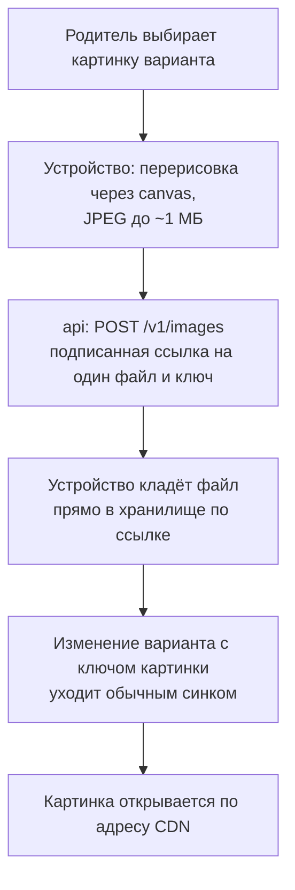

# ADR-009. Минимум персональных данных и фото

**Статус:** предложен, 20.10.2026.

Что сервер знает о семье, где живут изображения, что попадает в логи и события и как удаляются
данные. Таблицы — ADR-007, вход — ADR-008. Юридические обязанности оператора — уведомление РКН,
согласие родителя, политика обработки, для EU представитель по Art. 27 и оценка рисков — отдельный
юридический этап, здесь только то, что влияет на архитектуру и код.

## Контекст

- Персональные данные (ПДн) — всё, по чему можно узнать человека: имя ребёнка вместе с аккаунтом
  родителя, история его задач, фото, IP-адрес.
- Сейчас все данные лежат только на устройстве: имена и фото детей в строке `children`, картинки
  вариантов наград в `variantPhotos`, всё это попадает в экспорт JSON.
- С бэкендом данные семьи переезжают на сервер. Полностью уйти от ПДн нельзя: аккаунт, имена
  детей и история — это ПДн, оператором мы остаёмся в любом случае.
- Данные не выходят из своего контура: база, хранилище, бэкапы, логи и ошибки — внутри RU или EU
  (ресерч `03`).
- Худшее для детского приложения — утечка фото детей. Меньше данных — меньше последствий утечки
  и проще юридический этап.

## Решение

### 1. Принцип: храним только то, без чего приложение не работает

| Данные | ПДн? | Где живут |
|---|---|---|
| Аккаунт родителя | Да, даже в виде хеша: мы можем сопоставить его с человеком | Сервер: `HMAC(идентификатор, AUTH_PEPPER)` и открытые ключи passkey (ADR-008) |
| Email, имя, телефон, аватар родителя | Да | Нигде. Вход по почте позже хранит только хеш адреса |
| Токены провайдера входа | — | Нигде: после входа к провайдеру не ходим |
| Имя ребёнка, каталог, история отметок и покупок | Да, вместе с аккаунтом | Сервер и устройство, в открытом виде |
| Фото ребёнка | Да | Нигде — вместо фото аватарки из набора, раздел 2 |
| Аватарки, иконки | Нет: одинаковые для всех | Сборка фронта |
| Картинки вариантов наград | Нет: фото товара, а не человека | Объектное хранилище контура за CDN, раздел 3 |
| Push-подписка устройства | Да: адрес, по которому можно достучаться до устройства | Схема `notifications` своего контура (ADR-010) |
| IP-адрес, User-Agent | Скорее да | Не пишем никуда надолго. Для лимитов запросов IP живёт в Valkey минуты |

Имена детей, каталог и историю на сервере не шифруем:

- сервер сам работает с этими данными: сливает изменения по полям, проверяет их, позже пишет
  уведомления;
- шифрование на устройстве требует ключа, который семья может потерять вместе с устройством, —
  тогда пропадут и данные;
- для РКН шифротекст, связанный с аккаунтом, — тоже ПДн, оператором мы остаёмся.

Защищаем по-другому: изоляция семей в коде и в Postgres (ADR-007), бэкапы шифруем сами до отправки
в хранилище, в логах и событиях нет ПДн (раздел 5), данные не выходят из контура.

### 2. Аватарки вместо фото детей

- Загрузку фото ребёнка убираем. В редакторе ребёнка вместо «Загрузить фото» — сетка рисованных
  аватарок, родитель выбирает одну.
- Аватарки — рисованные картинки в `apps/web/public/avatars/`, исходники рядом в `art/`, как у
  иконок. Скрипт их не генерирует.
- В строке ребёнка вместо `photo` — `avatarId`, ссылка на аватарку из набора.
- Схема чтения снисходительна к старым строкам: строка с `photo` читается, поле `photo` отбрасывается,
  ребёнок получает аватарку по умолчанию. При следующей записи строки фото исчезает и с устройства.
  На сервер оно не уходит ни при синхронизации, ни при первой выгрузке после входа.
- Экспорт JSON больше не выгружает `photo`, импорт старого файла поле пропускает. Версия бэкапа
  растёт.
- **Когда.** Вместе с версией, в которой фронт начинает работать с сервером. Отдельно, раньше
  бэкенда, не делаем: до этого фото живут только на устройстве, как сейчас.

### 3. Картинки вариантов наград

Картинки вариантов — например, разные наборы Лего — лежат в объектном хранилище контура и
раздаются через CDN.

| Контур | Хранилище | CDN |
|---|---|---|
| EU | Hetzner Object Storage | Cloudflare, через него уже раздаётся фронт |
| RU | Yandex Object Storage | Yandex Cloud CDN |
| Локально | SeaweedFS в Compose | nginx контура |

Как загружаем:

- Ссылку выдаёт `api` только при живой сессии. Она живёт 5 минут, разрешает положить один файл
  с заданным ключом, типом `image/jpeg` и длиной не больше ~1 МБ — длина входит в подпись.
- Файл идёт в хранилище напрямую, мимо `api`: сервер не гоняет через себя картинки, база не
  раздувается.
- Имя файла — случайный id: без названия награды и без id семьи. Список файлов бакета закрыт,
  картинку можно открыть, только зная её ключ. Страницы с картинками не индексируются.
- Без сети картинка ждёт в `variantPhotos` на устройстве и загружается перед отправкой изменения
  варианта. У гостя картинки так и живут в `variantPhotos`, на сервер не уходят.
- Для работы без сети уже загруженные картинки кеширует service worker.
- Вариант уходит в архив — картинка остаётся: на неё ссылается история выбора.
- Файлы, которые загрузили, но так и не привязали к варианту, раз в сутки удаляет задача очистки,
  если им больше суток.
- Картинки из магазинов защищены авторским правом. Используем их внутри семьи по случайным
  ссылкам, публичной галереи нет.

**Локальное хранилище — SeaweedFS.** У локального контура нет облачного хранилища, а код `api`
должен работать с тем же S3-совместимым API, что и в контурах:

- SeaweedFS — лицензия Apache 2.0 без условий, как у Valkey; готовый образ, один контейнер,
  подписанные ссылки поддерживает;
- бакет `media`, nginx контура проксирует `/media/*` в SeaweedFS с исходным заголовком `Host`.
  Ссылка подписывается на адрес контура (`http://localhost:8080/media/...`), SeaweedFS проверяет
  подпись по нему же, загрузка и показ идут с того же адреса, что и приложение, — CORS не нужен,
  как и за CDN на проде;
- на проде у бакета разрешён CORS только для адреса приложения.

### 4. Обработка изображений на устройстве

- Перерисовка через canvas удаляет все метаданные снимка, включая координаты GPS. Поворот снимка
  применяем до перерисовки: `createImageBitmap(file, { imageOrientation: 'from-image' })`.
- Формат — JPEG, качество ~0,8. Safari не умеет сохранять canvas в WebP и молча отдаёт PNG.
- Размер картинки варианта — ~1024 px по длинной стороне: в окне выбора она крупная.
- Функция сжатия одна — `shared/lib/resizePhoto.ts`, размер и способ вписывания — параметрами.

### 5. Логи, ошибки и события

- **Логи `api` и `notifications`** — pino в JSON: вместо имён id, без IP, User-Agent, cookie,
  токенов и тел запросов.
- **nginx** пишет журнал запросов без IP и User-Agent — свой формат строки вместо стандартного.
- **Ошибки** уходят в сборщик ошибок своего контура без тел запросов, cookie и заголовков
  авторизации.
- **Лимиты запросов** считают по IP в Valkey, счётчик живёт минуты.
- **События** в Valkey Streams несут только id: семьи, ребёнка, задачи, награды. Имён, PIN и
  картинок в событиях нет (ADR-006).
- **Push** идёт через серверы Apple и Google, то есть за пределы контура. Поэтому в тексте push
  нет имён детей и других данных семьи: подробности приложение показывает уже у себя, после
  открытия (ADR-010).
- Логи и ошибки хранятся до 14 дней — столько же, сколько бэкапы.

### 6. Удаление данных

| Что удаляем | Что происходит |
|---|---|
| Ребёнка | Как сейчас: в архив, история и баланс сохраняются |
| Семью | В родрежиме, с подтверждением. Строки семьи в `core` удаляются одной транзакцией, вместе с её строками в `outbox`; остаётся только само событие `family.deleted`. Удаляются сессии всех устройств семьи. Событие `family.deleted` — по нему `notifications` удаляет подписки, расписания и ленту семьи. После транзакции задача удаляет картинки вариантов по ключам из строк семьи и повторяет попытки, пока не удалит всё |
| Аккаунт | Удаляются пользователь, его способы входа, passkey и сессии. Родитель в семье один, поэтому вместе с аккаунтом удаляется и семья — как в строке выше |
| Данные на устройстве | «Выйти» удаляет локальную базу (ADR-008). У гостя данные удаляются вместе с данными сайта в браузере; кнопка сброса в родрежиме — в роадмапе, P0 |

- Удаление настоящее, а не пометка: пометка удаления нужна синхронизации внутри живой семьи, а
  удалённой семье синхронизироваться не с кем.
- Бэкапы базы не правим. Удалённая семья пропадает из них сама, когда бэкапы старше срока
  хранения удаляются: в EU WAL-G хранит 7–14 дней, в RU managed Postgres — 7 дней.
- Бэкапы шифрует WAL-G ключом контура до отправки в хранилище.

## Рассмотренные варианты

| Вопрос | Варианты | Почему выбрали так |
|---|---|---|
| Фото детей | Загрузка в закрытое хранилище по подписанным ссылкам; шифрование на устройстве; **аватарки из набора** | Самый чувствительный вид ПДн исключён целиком: без закрытых бакетов, согласий на фото и ключей, которые семья может потерять |
| Имена и история на сервере | Шифровать на устройстве; **хранить открыто** | Серверу нужно сливать изменения и проверять данные; ключ можно потерять вместе с данными; оператором мы остаёмся и с шифрованием |
| Где картинки вариантов | В Postgres; через `api` в хранилище; **напрямую в хранилище по подписанной ссылке** | База не раздувается, `api` не гоняет через себя файлы, CDN раздаёт картинки быстро |
| Локальное хранилище | MinIO; Garage; **SeaweedFS** | Репозиторий MinIO в архиве с апреля 2026, готовых образов нет с октября 2025. Garage — под AGPL. SeaweedFS — Apache 2.0, готовый образ, подписанные ссылки и работа за прокси |
| Удаление семьи | Пометка и очистка позже; **сразу из базы, картинки — задачей** | Удалённой семье пометка ни к чему; картинки во внешнем хранилище удаляются отдельно и с повторами |
| Текст push | С именами детей; **без данных семьи** | Push проходит через серверы Apple и Google вне контура |

## Последствия

- Во фронте: набор рисованных аватарок и сетка выбора в редакторе ребёнка, `avatarId` вместо
  `photo` в схеме, новая версия бэкапа без `photo`. В `resizePhoto` — явный
  `imageOrientation: 'from-image'`.
- Картинки вариантов после входа загружаются по подписанной ссылке, у гостя остаются в
  `variantPhotos`.
- В `api`: `platform/storage` на S3 API — один код для SeaweedFS, Hetzner и Yandex; `POST
  /v1/images`; задачи очистки непривязанных файлов и удаления картинок семьи; `DELETE /v1/family`
  и `DELETE /v1/me`. Новые переменные — адрес хранилища, публичный адрес, бакет и ключи доступа.
- В Compose: сервис SeaweedFS с томом и маршрут `/media/*` в nginx.
- nginx и сборщик ошибок настраиваются без IP, User-Agent и тел запросов.
- Событие `family.deleted` в каталоге событий (ADR-006), его обработка в `notifications`
  (ADR-010).
- У каждого контура свой ключ шифрования бэкапов — секрет того же уровня, что `AUTH_PEPPER`.
