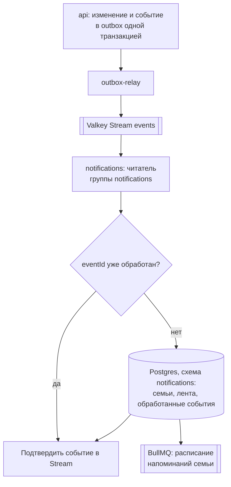

# ADR-010. Уведомления

**Статус:** предложен, 20.10.2026.

Какие уведомления получает семья, откуда они берутся и как доходят до устройства. Структура
сервиса `notifications` — ADR-005, события, из которых он узнаёт о происходящем, — ADR-006.

## Контекст

- `notifications` уже работает каркасом: читает Stream `events` своей группой `notifications`,
  пишет события в лог и отвечает на `GET /v1/notifications/health`. Своей базы у него пока нет.
- Web Push — стандарт браузеров для уведомлений с сервера, когда приложение закрыто. На iOS он
  работает с 16.4 и только у PWA, добавленной на экран «Домой»; разрешение браузер спрашивает
  только в ответ на нажатие пользователя.
- Push идёт через сервис push-уведомлений браузера: у Safari — Apple, у Chrome и Яндекс Браузера —
  Google (FCM). Это серверы вне нашего контура. В РФ при мобильных ограничениях FCM бывает
  недоступен, поэтому push — канал «по возможности».
- События несут только id, без имён (ADR-006). Почту и телефон родителя мы не храним (ADR-008).
- Уведомления есть только у аккаунта: гость работает на одном устройстве, сервер о нём не знает
  (ADR-008).

## Решение

### 1. Этапы

| Этап | Что появляется | Когда |
|---|---|---|
| Каркас | Чтение событий группой, лог, проверка здоровья | Сделано в `feat/backend-0.6` |
| Лента | Схема `notifications`, лента событий семьи в приложении, проверка сессии | Когда `api` начнёт писать события синхронизации (ADR-004) |
| Push и напоминания | Подписки Web Push по устройствам, ежедневное напоминание по часовому поясу семьи | После ленты |

Лента — главный канал: она работает на любом устройстве с аккаунтом. Push дополняет её там, где
доступен.

### 2. Какие уведомления будут первыми

| Уведомление | Откуда | Канал |
|---|---|---|
| Ребёнок выполнил задачу | `completion.recorded` | Лента |
| Отметку сняли | `completion.removed` | Убирает запись об этой отметке из ленты |
| Ребёнок получил награду или приз серии | `spend.recorded` | Лента |
| «Пора за дела» | Ежедневное напоминание в выбранное время | Push |

- На события push не отправляем: отметок за день десятки, это спам. К тому же событие не знает,
  с какого устройства пришло, и push получило бы устройство, на котором только что нажали
  «Принять».
- «Неделя закрывается» добавим, когда решим, считаются награды за неделю или за всё время
  (роадмап, «Определиться: недельные vs накопительные»).

### 3. Откуда берутся уведомления

- Каждое событие обрабатывается в одной транзакции с записью его `eventId` в
  `processed_events`. Пришло повторно — пропускаем и подтверждаем.
- Событие подтверждается в Stream только после коммита. Упал обработчик — событие выдаётся
  повторно; повторы и поток необработанных — по правилам ADR-006.
- В ленту попадают только отметки и покупки за сегодня и вчера по часовому поясу семьи — по полю
  `day` и времени события. Первая выгрузка данных гостя после входа присылает события за прошлые
  дни (ADR-006), лента их пропускает.
- `family.created` и `family.updated` сохраняют часовой пояс семьи и перестраивают её
  расписание. `family.deleted` удаляет всё о семье в схеме `notifications` и её расписание.

### 4. Текст уведомлений собирает устройство

- Сервер не хранит имён детей, названий задач и наград и не пишет тексты. В ленте и в push лежат
  только тип и id: `{ type, childId, taskId, rewardId, points }`.
- Приложение подставляет имена из своей IndexedDB и пишет текст на языке устройства по словарю
  `shared/i18n`. Не нашло запись — показывает общий текст: «Задача выполнена».
- Push-уведомление собирает service worker: он получает тип и id, читает имена и язык из
  IndexedDB и показывает уведомление. iOS требует показать уведомление на каждый push, поэтому
  при любой ошибке service worker показывает общий текст «Пора за дела».
- Содержимое push шифруется ключами подписки устройства: сервис Apple или Google видит адрес
  доставки, размер и время, но не содержимое. Имён в содержимом всё равно нет.

### 5. Web Push

- **VAPID** — пара ключей, которой наш сервер подписывает запросы к сервису push: сервис
  проверяет, что push отправил тот же сервер, который получил подписку. Ключи свои у контура:
  `VAPID_PUBLIC_KEY`, `VAPID_PRIVATE_KEY` и контакт отправителя `VAPID_SUBJECT`.
- Отправка — библиотека `web-push`.
- Разрешение на push приложение спрашивает только по кнопке «Включить напоминания» в настройках,
  никогда при запуске. На iPhone и iPad без установки на экран «Домой» кнопка объясняет, что
  сначала нужно добавить приложение на экран.
- Подписка принадлежит устройству из сессии (`devices`, ADR-008): одно устройство — одна
  подписка. Приложение обновляет её при каждом открытии.
- Подписка удаляется, когда:
  - родитель выключил напоминания на этом устройстве;
  - устройство выходит из аккаунта — приложение удаляет подписку до `POST /v1/auth/logout`;
  - сервис push ответил, что подписки больше нет (`404` или `410`);
  - приложение не обновляло её 30 дней — столько живёт сессия, и устройство, скорее всего, уже
    не в аккаунте.

### 6. Напоминания

- **BullMQ** — очередь задач поверх Valkey: умеет отложенные и повторяющиеся задачи, повторяет
  упавшие и переживает перезапуск процесса.
- Напоминание — настройка семьи: включено или нет, время и дни недели. По умолчанию выключено,
  время — 18:00. Включается вместе с первой подпиской на push в семье.
- На каждую семью — одна повторяющаяся задача BullMQ с расписанием в часовом поясе семьи. Сменился
  часовой пояс или настройка — задача пересоздаётся.
- В нужное время задача отправляет push на все подписки устройств семьи и пишет каждую отправку
  в журнал `deliveries`.
- Valkey работает с `noeviction`: BullMQ не терпит, когда Valkey сам выбрасывает ключи. В
  `compose.yaml` это уже так.

### 7. Таблицы схемы `notifications`

| Таблица | Что хранит |
|---|---|
| `families` | Копия из событий: id семьи и часовой пояс |
| `processed_events` | `eventId` обработанных событий — повтор не применяется второй раз |
| `feed_items` | Лента: тип, id из события, время события, `eventId` |
| `feed_cursors` | До какого времени лента прочитана на каждом устройстве |
| `push_subscriptions` | Устройство, адрес доставки и ключи подписки, время обновления |
| `reminders` | Напоминание семьи: включено, время, дни недели |
| `deliveries` | Журнал отправок: подписка, вид, результат, время |

- У каждой строки есть `family_id`, и защита строк в Postgres такая же, как в `core` (ADR-007):
  транзакция начинается с `set_config('app.family_id', ...)`. Семью обработчик берёт из события,
  HTTP — из сессии, задача BullMQ — из своих данных.
- Работает со схемой роль `app_notifications`, миграции — своя Prisma-схема сервиса, применяет их
  `migrate` (ADR-005).
- Ленту, журнал отправок и `processed_events` храним 30 дней, чистит их ежедневная задача BullMQ.

### 8. HTTP

Все пути под `/v1/notifications`, nginx отправляет их прямо в `notifications`.

| Метод и путь | Что делает |
|---|---|
| `GET /v1/notifications/health` | Проверка здоровья, без сессии |
| `GET /v1/notifications/feed?before=...` | Лента семьи страницами и число непрочитанных на этом устройстве |
| `POST /v1/notifications/feed/read` | Отметить ленту прочитанной до момента на этом устройстве |
| `GET /v1/notifications/push/key` | Открытый ключ VAPID для подписки |
| `PUT /v1/notifications/push/subscription` | Сохранить или обновить подписку этого устройства |
| `DELETE /v1/notifications/push/subscription` | Удалить подписку этого устройства |
| `GET /v1/notifications/reminders`, `PUT /v1/notifications/reminders` | Настройка напоминания семьи |

- Сессию `notifications` проверяет сам: читает cookie и находит сессию в Valkey по хешу её id,
  как `api` (ADR-008). Срок сессии продлевает только `api`.
- Те же проверки, что в `api`: `Origin` на изменяющих запросах, `X-App-Version` и лимит запросов
  по сессии. Нет сессии — `401`.
- Ключ сессии в Valkey и способ хеширования описаны в `packages/contracts`, чтобы оба сервиса
  читали сессию одинаково.

### 9. Чего нет

- **Почты.** Контактов родителя не храним (ADR-008). Канал появится не раньше входа по почте.
- **Нативной обёртки.** Capacitor для надёжного push на iOS рассматриваем, только если Web Push
  окажется недостаточным.
- **Мгновенной ленты.** Приложение забирает ленту при открытии и при возврате в него, как
  изменения синхронизации; WebSocket не нужен.
- **Обратной связи разработчику через Telegram-бота.** Это сообщение от семьи разработчику, а не
  уведомление семьи, и в этот сервис не входит.

## Рассмотренные варианты

| Вопрос | Варианты | Почему выбрали так |
|---|---|---|
| Главный канал | Только push; только лента; **лента и push по возможности** | Push на iOS есть только у PWA на экране «Домой», в РФ FCM бывает недоступен. Лента работает везде, где есть аккаунт |
| Текст уведомлений | Сервер пишет текст с именами; **сервер шлёт тип и id, текст собирает устройство** | Имена детей не попадают на сервер уведомлений и в сервисы push, язык — язык устройства |
| Push на события | Push на каждую отметку; **в первой версии только напоминание** | Отметок за день десятки, и событие не знает, с какого устройства пришло |
| Где хранить подписки | В `core` через событие о подписке; **в схеме `notifications`, напрямую по HTTP** | Подписки нужны только уведомлениям, лишняя таблица в ядре и лишнее событие ни к чему |
| Расписания | Таймер в процессе; таблица и опрос раз в минуту; **BullMQ** | Повторяющиеся задачи в часовом поясе, повтор при сбое и переживание перезапуска из коробки, Valkey уже есть |
| Защита от повторов | Делать обработку безопасной для повтора в каждом обработчике; **таблица `processed_events` в той же транзакции** | Одно правило на все обработчики, повтор виден по `eventId` |

## Последствия

- В `apps/notifications` появляются Prisma-схема `notifications`, обработчики событий, BullMQ,
  `web-push` и проверка сессии. В `compose.yaml` сервису нужны `DATABASE_URL` своей роли, ключи
  VAPID, `PUBLIC_ORIGIN` и `MIN_CLIENT_VERSION`; `migrate` применяет и его миграции.
- В `packages/contracts` — схемы HTTP уведомлений, формат содержимого push и ключ сессии в Valkey.
- Во фронте — страница «Уведомления» со счётчиком непрочитанных в сайдбаре, кнопка «Включить
  напоминания» в настройках и свой service worker: `vite-plugin-pwa` переходит в режим, где мы
  пишем service worker сами, с обработкой push и словарём текстов на трёх языках.
- На iPad проверяем: доходит ли push до PWA с экрана «Домой» и успевает ли service worker
  прочитать имена из IndexedDB.
- Push в РФ может не доходить совсем — там семья видит уведомления только в ленте.
